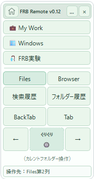
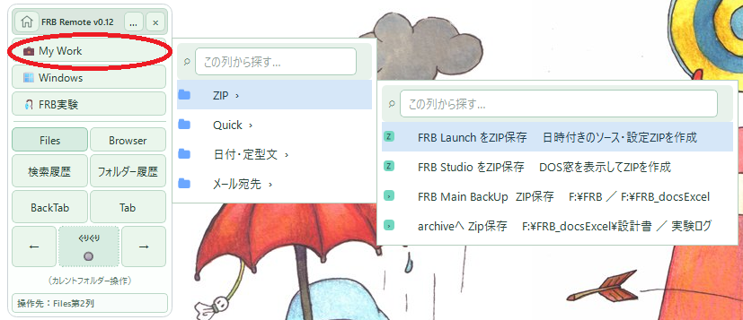
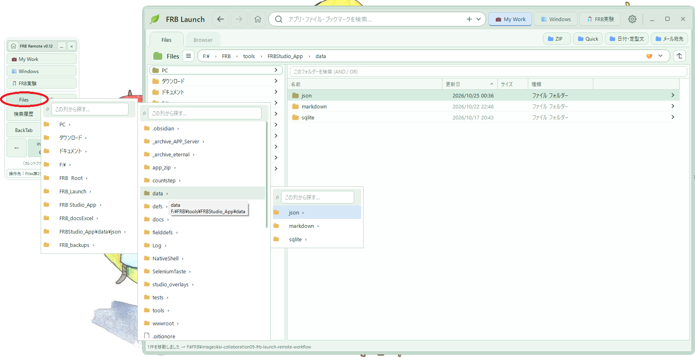
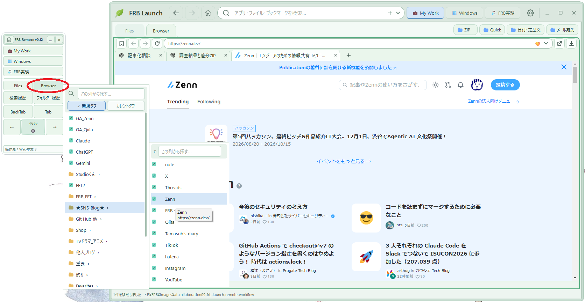
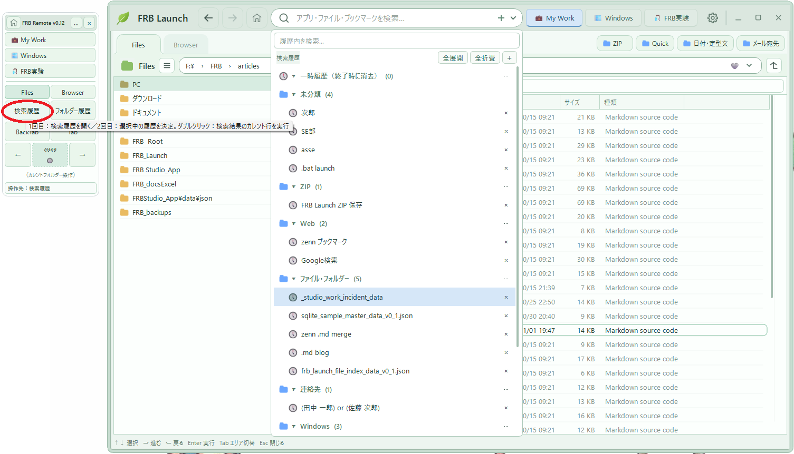
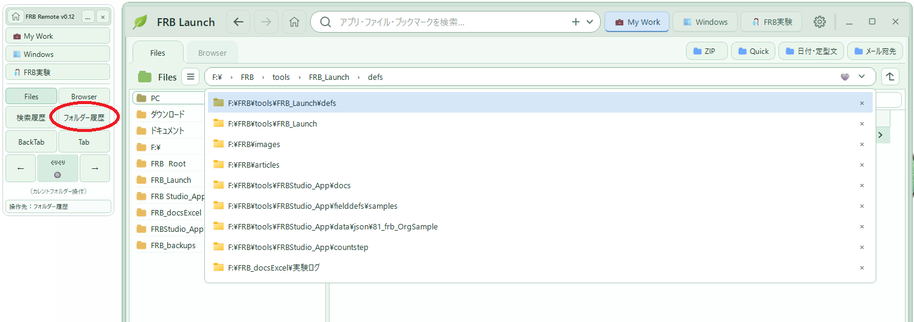
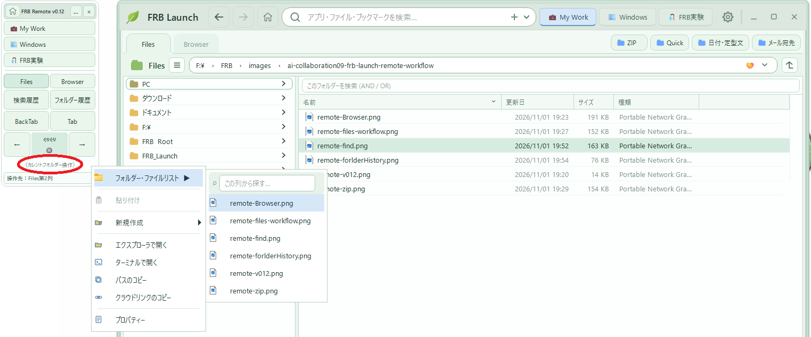

## はじめに——リモコンを作った、その後の話（笑）

前回、こんな記事を書いた。

[AI協働：FRB Launch続々報 — マウスを動かしたくなくて、リモコンが生まれた話（笑）](https://zenn.dev/frb_tamasub/articles/ai-collaboration08-frb-launch-remote-experience)


自作ランチャー「FRB Launch」をマウスホイールで気持ちよく操作していたら、いつの間にか小さなリモコン「FRB Remote」が生まれてしまった、という話だった。

その記事の最後に、こんなことを書いた。

> 操作対象は移動する。操作位置は移動しない。

あれから、また少しずつリモコンを育ててみた。

すると、予想していなかったことが起きた。

**リモコンが便利になったというより、パソコン作業の始め方そのものが変わってしまった（笑）。**

## いま、最初に開くのはFRB Remote

最近の私の作業開始は、こんな感じになっている。

デスクトップのショートカットをダブルクリックする。

起動するのは、FRB Launchの本体画面……ではなく、まずは小さな **FRB Remote**。



小さな画面に、よく使うページやFiles、Browser、検索履歴、フォルダー履歴、Tab、左右移動などの操作を集めている。

そして、このリモコンから必要なものを呼び出す。

気づけば、**作業のスタートはリモコンから**、という使い方がメインになっていた。

……いや、これ、最初は「昨日の日付を入力したい」だけだったはずなんやけど（爆笑）。

## その1——操作メニューを呼び出すのが、妙に気持ちいい

例えば、ZIP作成。

以前は、ZIPを作るためのメニューやバッチを探して、そこまでマウスを動かしていた。

でも今は、FRB Remoteから操作メニューを呼び出せる。

リモコンで対象や操作を選ぶ。そのまま次の操作に進む。




これが、妙に気持ちいい。

別にZIP作成が、世界を変えるほど高速になったわけではない（笑）。

ただ、**「次に何をするか」を考えた場所から、そのまま操作できる。**

この小さな違いが、思っていた以上に大きかった。

## その2——Filesでフォルダーを選んで、Launch側で作業する

今回、一番気に入っているのがこれ。

リモコンの **Files** から、作業したいフォルダーを選ぶ。

すると、FRB Launch側のエクスプローラーで、その場所を扱える。



画像では、リモコンの横にフォルダー階層が展開され、Launch本体にはFilesの作業画面が表示されている。

フォルダーを探すのはリモコン側。

ファイルを見たり、作業したりするのはLaunch側。

**「作業場所を選ぶ」と「そこで作業する」が、きれいに分かれた。**

これが、実に気持ちいい（笑）。

Windowsのエクスプローラーが悪い、と言いたいわけではない。

ただ、私が日常的に使うフォルダーへたどり着くまでの操作を、自分の好きな形にできた。

その結果、作業に入るまでがずいぶん自然になった気がする。

## その3——Browserも、ブックマーク選択から始める

同じことがBrowserでも起きた。

リモコンの **Browser** ボタンからブックマークを選ぶ。

選んだページは、FRB Launch側のブラウザーに表示する。





これも気持ちいい。

いつも見るページなのに、ブラウザーを開いて、ブックマークを探して、クリックする。

もちろん、それでも十分便利だ。

でも、リモコンの中に「行きたい場所」がまとまっていると、

**自分が何を見たいか決まった瞬間に、そこへ向かえる。**

FilesでもBrowserでも、やっていることはよく似ていた。

## その4——検索履歴が、マウスホイールだけでつながってしまった

今回、いちばん「おぉーー！」となったのは、実は検索履歴かもしれない。

たとえば、以前検索したファイルをもう一度探したいとする。

まず、デスクトップのショートカットをダブルクリックして、FRB Remoteを起動する。

マウスをほんの少し動かして、**「検索履歴」** をクリック。

すると、FRB Launch側に検索履歴の一覧が表示される。




そこからは、マウスホイールを **ぐりぐり** 回して対象まで移動する。

カーソルはその場のまま、クリック。

これで検索が実行され、検索結果の一覧が表示される。

さらに、またホイールをぐりぐり。

目的のファイルや項目まで移動したら、その場所でダブルクリック。

**選んだ対象のアクションが実行される。**

つまり、

```text
デスクトップをダブルクリック
        ↓
リモコンの「検索履歴」をクリック
        ↓
Launchの履歴一覧をホイールでぐりぐり
        ↓
その場でクリック → 検索実行
        ↓
検索結果をホイールでぐりぐり
        ↓
その場でダブルクリック → アクション実行
```

ほぼマウスを移動させずに、**マウスだけで一連の操作が完結する。**

これは、想像していた以上に気持ちよかった（笑）。

一度対象にカーソルを合わせたら、あとは画面のほうが動いてくれる。

前回書いた「操作対象は移動する。操作位置は移動しない。」が、検索から実行までつながった感じである。

## その5——フォルダー履歴は、さらに単純だった（笑）

検索履歴が気持ちいいなら、フォルダー履歴はもっと単純。

リモコンの **「フォルダー履歴」** をクリックする。




Launch側に表示された履歴をホイールで **ぐりぐり**。

行きたいフォルダーが来たら、その場でクリック。

すると、選んだフォルダーがLaunchのFilesに表示される。

それだけ（笑）。

```text
「フォルダー履歴」をクリック
        ↓
ホイールでぐりぐり
        ↓
その場でクリック
        ↓
LaunchのFilesにフォルダー表示
```

一度使った作業場所に戻るのが、妙に楽しい。

フォルダーを開く、という何でもない操作が、こんなに気持ちよくなるとは思っていなかった。

## その6——カレントフォルダーの操作までリモコンに載せてしまった

さらに調子に乗って、**カレントフォルダーのコンテキストメニュー操作**まで、リモコンから呼び出せるようにした。

今、Launchで表示しているフォルダーに対して、操作メニューを出せる。




たとえば、エクスプローラーで開く、ターミナルで開く、パスをコピーするといった操作を、リモコン側から選べるようにした。

**……いや、そこまでリモコンでやる必要ある？（笑）**

自分でも少し思う。

でも、作業フォルダーを選んだら、その流れのまま次の操作へ進める。

これも実際に触ってみると、なかなか気持ちいい。

もしかしたら、やりすぎかもしれない。

それを判断するのは、もう少し使い続けてからにしようと思う（笑）。

## 操作する場所と、作業する場所を分けてみた

今回の変化を、少し整理してみる。

```text
デスクトップから FRB Remote を起動
                ↓
リモコンで選ぶ
  ├─ 操作メニュー（ZIP作成など）
  ├─ Files → 作業フォルダー
  ├─ Browser → ブックマーク
  ├─ 検索履歴 → 検索 → 結果から実行
  ├─ フォルダー履歴 → 作業フォルダーへ移動
  └─ カレントフォルダー → コンテキストメニュー操作
                ↓
FRB Launch 本体で作業する
                ↓
必要になったら、またリモコンで選ぶ
```

前回は、**操作対象と操作位置を分離できた**ことに喜んでいた。

今回は、さらに一歩進んで、

**操作の入口と、実際の作業空間を分けたら気持ちよくなった。**

という体験だった。

リモコンは小さいままでいい。

全部の機能を詰め込む必要もない。

必要な場所を選び、必要な操作を呼び出せればいい。

広い画面が必要になったら、Launch本体に任せる。

リモコンが主役なのに、リモコンだけで全部をやろうとしていない。

この役割分担が、今のところ自分にはとてもしっくりきている。

## ViewとDataを分けていたことも、効いている気がする

FRB Launchでは、最初からメニューの内容をJSONで管理し、表示や操作の仕組みと分けることを意識してきた。

設定データは、別に作っている **FRB Studio（JSON Studio）** で編集できるようにしている。

そのため、よく使うフォルダーやブックマーク、操作メニューを育てるときも、メニューの中身と操作画面を分けて考えられる。

今回のリモコンの使い方は、この考え方と相性がよかったのかもしれない。

もちろん、操作感がよくなったこと自体は、私自身の体感でしかない。

でも、**人間が何をしたいかを選ぶ場所と、その結果を扱う場所を分ける**という考え方には、まだ面白い可能性がありそうだ。

## おわりに——「作業を始める場所」が変わった

振り返ると、ずっと同じことをやっている。

最初は、昨日の日付を入力するのが面倒だった。

矢印キーでメニューを操作すると気持ちよかった。

マウスホイールのぐりぐりが気持ちよかった。

マウスを動かしたくなくて、リモコンが生まれた。

そして今は、リモコンを起動するところからパソコン作業が始まっている。

大きな機能を一気に設計して、完成させたわけではない。

**小さな「気持ちいい」を追いかけていたら、いつもの作業の流れまで変わってしまった。**

今回の発見を、一言で残すなら、

> **操作の入口は小さく、作業する場所は広く。**

そして、もう一つ。

> **道具は、機能が増えたときだけでなく、使い始め方が変わったときにも進化する。**

ただし、これはまだ**できたてほやほやのUI**である。

今は、検索履歴もフォルダー履歴も、ホイールでぐりぐりするのが楽しくて仕方ない。

でも、しばらく使い続けたら、どう感じるのだろう。

「……やっぱり面倒やん」と思うようになるのか。

それとも、**「もうリモコンなしではパソコン作業できへん！」**となるのか（笑）。

今の気持ちよさが新鮮さによるものなのか、それとも日常に残る操作感なのか。まだ分からない。

だからこそ、自分の気持ちがどう変わっていくのか、ちょっと楽しみである。

……昨日の日付を入力したくなかっただけなのに、今度はパソコンの操作開始地点まで作り替えてしまった。

どこまで行くねん、FRB Launch！（爆笑）

---

FRB Launchは、以下のGitHubリポジトリで開発しています。

https://github.com/tamasub/FRB/tree/main/tools

※個人試作段階です。動作環境のセットアップ手順までは、まだ十分に整理できていません。

### 関連記事

- [AI協働：昨日の日付を入力したくなくて、ランチャーを作った話 — FRB Launch](https://zenn.dev/frb_tamasub/articles/ai-collaboration06-small-success-frb-launch)
- [AI協働：FRB Launch続報 — マウスホイールぐりぐりが魔法になった話（笑）](https://zenn.dev/frb_tamasub/articles/ai-collaboration07-frb-launch-wheel-experience)
- [AI協働：FRB Launch続々報 — マウスを動かしたくなくて、リモコンが生まれた話（笑）](https://zenn.dev/frb_tamasub/articles/ai-collaboration08-frb-launch-remote-experience)

この思考拡張・AI協働の実例として、私はFRB（Fishing Rod Benchmark）という個人研究も続けています。

[FRB（Fishing Rod Benchmark）釣り竿の「感度」を数値化する話 宣言](https://qiita.com/tamasub/items/2b6649748e1772b7eec1)
