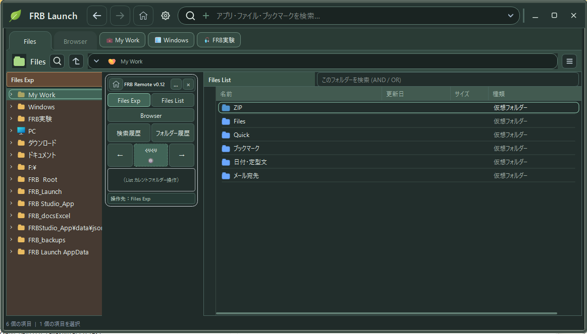

:::message

### この記事について

今回は、少し趣向を変えて、FRB研究所の記者会見というコント形式でお届けします（笑）。

技術ブログのZennで何をやっているんだ？と思われるかもしれませんが、内容は至って真面目です。

昨日の日付を入力するのが面倒だったところから始まった小さなツール開発が、操作体験を重ねるうちに、思いもよらない発見へとつながっていきました。

この記事で本当に伝えたいのは、「体験の連鎖から新しい発見が生まれる」という、AI協働による思考拡張の可能性です。

どうか、しばしコントにお付き合いください（笑）。

:::

# FRB Launch +　FRB Remote

# 世界標準規格の野望・第2弾 — みんなも、ぐりぐりしてみませんか？（笑）

## FRB研究所、緊急記者会見（笑）

記者「所長！ 世界標準規格の第2弾を発表されるそうですね！」

所長「はい。ついに、そこまで来ました。」

記者「第1弾は何でしたっけ？」

所長「**釣り竿の感度ベンチマーク規格**です。」

記者「……釣り竿？」

所長「FRB。Fishing Rod Benchmarkです。ロッドの『感度』を振動として測定し、FFT解析などで比較・可視化して、共通言語にしようという研究です。」

記者「世界標準になったんですか？」

所長「**まだ研究中です。魚がなかなか協力してくれません。**」

記者「…………。では、第2弾は？」

所長「**OKとCancelを、マウスホイールでぐりぐり選べるようにしませんか？**」

記者「…………はい？」

所長「以上です。」

記者「**以上！？**」

こうして、FRB研究所の第2弾・世界標準規格の発表は始まった。

もちろん、世界標準として認定されたわけではない。**自称・世界標準規格の野望**である（笑）。

## そもそも、昨日の日付を入力したくなかった

記者「所長、そんな壮大な研究は、どんな問題意識から始まったのですか？」

所長「昨日の日付です。」

記者「……昨日の日付？」

会社のシステムで、昨日の日付を入力するのが面倒だった。

そこで会社のCopilotくんに、ショートカットキーで呼び出せる小さなテキストランチャーを作ってもらった。

キーを押す。メニューを選ぶ。昨日の日付が入力される。

本来なら、これで研究終了である。

ところが、妙な事件が起きた。

**左右の矢印キーで、メニューが出たり引っ込んだりする操作が、なんだか気持ちいい。**

「おおぉーーー。なんやこれ。脳みそが喜んでる！！（笑）」

日付を入れるための道具だったはずが、いつの間にか、**この気持ちよさをもう少し味わいたい道具**になっていた。

そこで家のChatGPTくんと一緒に、FRB Launchを育て始めた。

## 第2の事件。Pageタブが、ぐりぐり気持ちいい

アプリ起動、定型文、ファイル検索、フォルダー、ブックマーク……。

こつこつ機能を増やしていたある日、Pageタブをマウスホイールで切り替える操作に出会った。

ぐりぐり。パラパラ。

……ん？

**「これも、めっちゃ気持ちいいぃーーー！！」**

ならばメニューも、ファイル一覧も、全部ぐりぐりできるようにしたい。

ところが、選択できても、最後はその項目までマウスを動かさなければならない。

「結局、そこまでマウスを動かすんかい！」

ならばポインターを自動で追いかけさせよう。

そうして試しているうちに、また変なことに気づいた。

**スクロールって、『相手がこっちに来てくれる』操作だった。**

ポインターはそのままでも、一覧のほうが動いて、対象が目の前にやって来る。

このスピード感は壊したくない。

だから、スクロールできる間はスクロールに任せ、端で止まった後だけカレントやポインターを動かすハイブリッド方式を試した。

……なんだか研究っぽい話になってきた（笑）。

記者「では、そのハイブリッド方式が今回の世界標準規格ですか？」

所長「**いいえ。関係ありません。**」

記者「…………」

## マウスポインターを動かすくらいなら、リモコンを作ろう

今度は、もっと根本的な疑問が浮かんだ。

「選択している行は分かってるんやから、毎回ポインターをそこまで動かさなくてもよくない？」

だったら、マウス操作を小さな場所に集約するリモコンを作ってしまえ。

こうして生まれたのが、**FRB Remote**。

ぐりぐりでカレントを移動。クリックで実行。右クリックでコンテキストメニュー。

しかも操作メニューは、対象のファイルの近くではなく、リモコンの横に出せる。

**操作対象がある場所と、人間が操作する場所は、同じでなくていい。**

おおぉーーー。これは便利！（笑）

しかし、便利になったら、また次の違和感が現れた。

## 嫌いだったExp方式が、まさかの主役へ

私は、Windowsのエクスプローラーでフォルダーを階層展開するツリー表示が、あまり好きではなかった。

インデントが狭くて階層が分かりにくいし、使いたい作業フォルダーから気軽に始めたい。

ところが、PythonのGUI部品なら、**任意のフォルダーを起点にして、インデント幅も自分好みにできる**と分かった。

「おん？ それなら話が違うぞ？」

自称 **Exp方式** の誕生である（笑）。

まずはRemote側にExp機能を載せた。

……便利やん！

ならばLaunch本体の第1列へ昇格させよう。第2列はファイル一覧のList。

ところが、今度はリモコンの置き場所がしっくりこない。

そこで背景を透明にしてみた。

**Launchの文字とRemoteの文字が重なった。**

……見えへんやん！！（爆笑）

だったら、重ならないように場所を作ったらええのでは？

**第1列と第2列の間に、リモコン専用のスペースを作ろう！**

こうして、歴史に残る……予定の、**第1.5列革命**が勃発した。

記者「第1.5列という名前に、何か技術的な意味が？」

所長「第1列と第2列の間だからです。」

記者「……なるほど。」

## 第1.5列革命。最大の成果は、要求が増えたこと

第1.5列の真ん中にRemoteを置いた。

左はExp、右はList。

すると、不思議なことが起きた。

「ここにリモコンがあるんやったら、左右をもっと自然に行き来できるはずや！」

「Expをぐりぐりしたら、Listも追従してほしい！」

「今どっちを操作しているか、一目で分かってほしい！」

「右クリックメニューも、ぐりぐりで選びたい！」

第1.5列を作ったことで、**それまで思いつかなかった操作性への要求が、次々と生まれた。**

そして、その要求を一つずつ実装していった。

ある日、第1.5列表示モードを解除して、RemoteをLaunchの外へ出して使ってみた。

すると……。

**「あぁ～らびっくり！ 外に置いても、めっちゃ操作しやすいやん！！」**

記者「所長！ では第1.5列は不要だったのですか？」

所長「いいえ。**第1.5列に置いたからこそ、ここまで操作性を要求したんです。**」

記者「でも、最後は外したんですよね？」

所長「はい。」

記者「…………」

所長「**場所に依存しない操作体系が、場所にこだわった実験から生まれました。**」

……あれ？ ちょっといい話になってしまった（笑）。

## 記者会見、いったん中止。原因はOKとCancel

さて、コンテキストメニューもRemoteで操作できるようになった。

ぐりぐり。右クリック。ぐりぐり。実行。

いよいよマウスをほとんど動かさずに済む。

ところが、削除などの操作をすると、確認ダイアログが出てくる。

**OK。Cancel。**

……遠い。

ここだけボタンのところまでマウスを動かさないといけない。

リモコンへポインターを戻す距離まで考えると、普通にボタンを押すほうが早い場合すらある。

記者「所長、マウス移動0mmの記者会見を始めてもよろしいですか？」

所長「**中止です。**」

記者「えっ？」

所長「**OKとCancelが遠すぎます。**」

……世界標準規格の発表が、確認ダイアログで止まった（爆笑）。

だったら、このOKとCancelも、ぐりぐりで選べるようにしたらええやん。

ホイールで選択を移し、クリックで確定する。勝手にOKを押すわけではない。

やってみた。

**できたぁぁぁーーー！！（笑）**

そして、この瞬間に、脳みそがまた余計なことを思いついた。

**「あれ？ これ、世の中のアプリがみんな対応してくれたら、便利なんちゃう？」**

## そして、思考だけが世界規模へ飛躍した

記者「所長！ ついに世界標準規格の中身が分かりました！」

所長「はい。」

記者「ハイブリッド方式や第1.5列革命も規格に含まれるのですね？」

所長「**いいえ。含まれません。**」

記者「では、標準化したいものは？」

所長「**OKとCancelを、ぐりぐりで選べることです。**」

記者「……それだけですか？」

所長「はい。」

記者「現在の利用者数は？」

所長「**1人です。私です。**」

記者「世界への普及見通しは？」

所長「**少なくとも私には大好評です。**」

記者「…………」

所長「**でも、夢は世界規模です。**」

ぎゃははははははは！！（爆笑）

もちろん、これは既存のGUI操作技術の新規性や、正式な国際規格を主張する話ではない。

自分が気持ちいいと感じた操作を、ほかのアプリでも当たり前に使えたら面白いなぁ、という**個人研究者の勝手な提案**である。

そして、こんな一文が生まれてしまった。

> **開発の歴史は壮大。提案は極小。野望は世界規模。**

## でも、本当に伝えたかったのは「思考拡張」の話

この話をコントとして終わらせるのは簡単だ。

ただ、私には、もう一つ残しておきたいことがある。

**最初から、OKとCancelのホイール操作を思いついていたわけではない。**

昨日の日付を入れたくなかった。

左右キーが気持ちよかった。

Pageタブのホイールに脳が反応した。

スクロールの見方が変わった。

Remoteを作り、Expが便利になり、第1.5列に置いたら新しい要求が増えた。

第1.5列を外しても操作できるようになった。

そして、最後に残ったOKとCancelへの数センチが、世界規模の妄想を連れてきた（笑）。

ここで大切だったのは、立派な完成図を最初から描くことではなかった。

**作る。触る。脳みそが喜ぶ。あるいは違和感を覚える。AIと話す。少し直す。もう一度触る。**

その体験が、次に欲しいものを教えてくれた。

私は、こうした過程を「思考拡張」と呼んで考えている。

> **体験は、要求を検証するだけのものではない。**
> **まだ存在していなかった要求を、発見するためのものでもある。**

そして、

> **体験の連鎖から、新しい発見が生まれる。**

FRBの釣り竿感度研究でも、床を擦った感触、ロッドによる振動の違い、ESP32での計測、FFTのグラフ……そうした体験と観測が、次の問いを生み出してきた。

**ロッドの感度を追いかけていた研究所が、今度はマウスホイールの感度に夢中になっている。**

……いや、研究対象の振れ幅が大きすぎるやろ！（爆笑）

## 発表会、最後の質問

記者「所長。世界標準規格第2弾の成果を、動画でも拝見できますか？」

所長「はい。YouTubeにデモがあります。」

記者「……画質が低くて文字が読みにくいのですが。」

所長「設定の歯車から、1080pを選んでください。」

記者「**……マウスで？**」

所長「はい。」

記者「**マウスを動かさない技術の動画を見るために、マウスを動かすんですか？**」

所長「…………」

所長「**YouTubeは、まだ我々の世界標準規格に対応しておりません。**」

……世界は、まだFRB研究所に追いついていない（爆笑）。

---

**FRB研究所。**

**研究は本気。発表はコント。野望は世界規模。成果はセンチメートル単位。**

**世界標準規格 第2弾。**

# みんなも、ぐりぐりしてみませんか？（笑）

---

### 関連記事・デモ

- [AI協働：昨日の日付を入力したくなくて、ランチャーを作った話 — FRB Launch](https://zenn.dev/frb_tamasub/articles/ai-collaboration06-small-success-frb-launch)
- [AI協働：FRB Launch続報 — マウスホイールぐりぐりが魔法になった話（笑）](https://zenn.dev/frb_tamasub/articles/ai-collaboration07-frb-launch-wheel-experience)
- [AI協働：FRB Launch続々報 — マウスを動かしたくなくて、リモコンが生まれた話（笑）](https://zenn.dev/frb_tamasub/articles/ai-collaboration08-frb-launch-remote-experience)
- [AI協働：FRB Launch続報 — リモコンから始めると、PC操作が気持ちよくなった話（笑）](https://zenn.dev/frb_tamasub/articles/ai-collaboration09-frb-launch-remote-workflow)
- 
- [FRB Launch デモ動画 1](https://youtu.be/NNfuqgh6GhA) / [デモ動画 2](https://youtu.be/1bvRIqDiu40)
- [FRB GitHub](https://github.com/tamasub/FRB/tree/main/tools)

- [FRB（Fishing Rod Benchmark）宣言 — ロッド感度を数値化する研究](https://qiita.com/tamasub/items/2b6649748e1772b7eec1)

※FRB Launchは個人開発の試作ソフトウェアです。操作感の評価は個人の体験に基づきます。

Fishing Rod Benchmark［FRB］By tamasub
