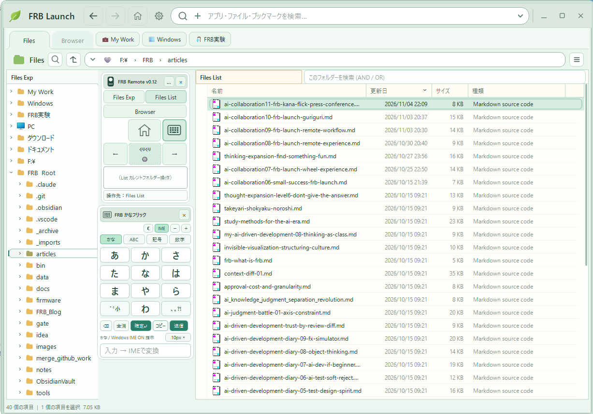
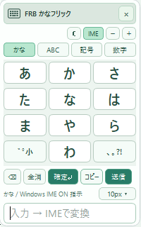
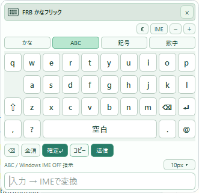
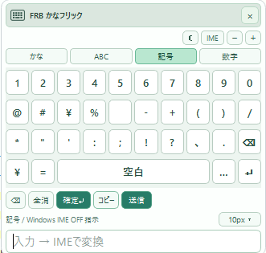
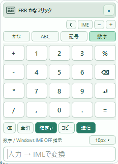

:::message
### はじめに — 今回もおちゃらけてごめんなさい（笑）

前回に引き続き、今回もFRB研究所の**架空の記者会見**というコント形式でお届けします。

冒頭からおちゃらけてしまって、ごめんなさい（笑）。

でも、実際に取り組んでいることは、わりと真面目です。これは**AIと一緒に小さな違和感を拾い、次の発想が生まれる過程を観察する「思考拡張」の実験**でもあります。

マウスの移動距離を減らしたくて作った小さなリモコン。中央の「ぐりぐり」を左右にフリックして「←」「→」ボタンの機能を代替することに成功しました。

そこで、ふと思ったのです。

**「フリック入力できるんなら、日本語も入力できるんじゃねぇ？」**


……で、本当に作ってしまいました（笑）。

（いつものCPTくんにがんばってもらいましたが、4～5Hかかってしまいました）

※「世界標準」や「救世主」は、もちろん記者会見の冗談です。需要調査や一般的な使いやすさの検証を終えたという話ではありません。
:::






# FRB研究所 緊急記者会見（笑）

*議題：FRB かなフリック誕生の経緯について*

**所長：** 本日、新しい日本語入力インターフェース「FRB かなフリック」を発表します。

**記者：** パソコンでフリック入力ですか？

**所長：** はい。

**記者：** なぜ作ろうと思ったんですか？

**所長：** もともと、マウスの移動距離を極小化する研究をしていました。

**記者：** なるほど。

**所長：** FRB Remoteという、小さなリモコンを作りましてね。中央に「ぐりぐり」というボタンがあります。

**記者：** ぐりぐり？

**所長：** はい。これを左右にフリックすることで、「←」「→」ボタンの機能を代替することに成功しました。

**記者：** それは便利そうですね。

**所長：** そうなんです。それで、ふと思ったんです。

**記者：** 何を？

**所長：** 「フリック入力できるんなら、日本語も入力できるんじゃねぇ？」

**記者：** ・・・・

**所長：** で、作っちゃいました。

**記者：** ・・・・

---

**記者：** ちなみに、パソコンでフリック入力をしたい人はいるんでしょうか？

**所長：** ここにいます。

**記者：** ほかには？

**所長：** ・・・・

**記者：** 需要調査は？

**所長：** 私が欲しいことは確認できています。

**記者：** ほかには？

**所長：** ・・・・

---

**記者：** しかし、パソコンで日本語を入力するなら、普通はキーボードを使いますよね？

**所長：** それはそうです。

**記者：** では、なぜ？

**所長：** 今、右手だけでパソコンを操作する研究をしているんです。

**記者：** 左手はどうしているんですか？

**所長：** 研究に参加していません。

**記者：** ・・・・

**所長：** しかも、マウスの移動範囲は最大1.5列以内という制約があります。

**記者：** 誰が決めたんですか？

**所長：** 私です。

**記者：** なぜ1.5列なんですか？

**所長：** ・・・・

---

**記者：** 最後に、FRBかなフリックの今後の展望をお願いします。

**所長：** パソコン操作の新しい可能性を切り開きたいと考えています。

**記者：** 具体的には？

**所長：** まだ分かりません。

**記者：** ・・・・

**所長：** でも、ぐりぐりを左右に動かしただけで、日本語入力まで来たんですよ？

**記者：** それは確かに予想外ですね。

**所長：** 私もそう思います。

**記者：** 研究計画は？

**所長：** ありませんでした。

**記者：** ・・・・

**所長：** 違和感を一個ずつ潰していたら、こうなりました。

**記者：** ありがとうございました。

**所長：** えっ、もう終わり？

---

## 記者会見のあとに — 思考拡張の実験として

今回、最初から「パソコン用のかなフリックを開発する」という計画があったわけではありません。

出発点は、**「←／→ボタンまでマウスを動かすのが面倒」**という、本当に小さな違和感でした。

```text
←／→ボタンへの移動が面倒
    ↓
中央「ぐりぐり」の左右フリックで代替
    ↓
フリック操作が成立した
    ↓
「日本語も入力できるんじゃねぇ？」
    ↓
FRB かなフリック誕生
```

今の実験の目的関数は、**マウスだけで操作を完結し、マウス移動距離を極小化すること**。右手だけで操作し、ブラウザーモードを除いて最大1.5列の範囲に収めることに挑戦しています。キーボードだけで操作する別の目標もありますが、そちらはいったん保留です。

だから、単に「キー入力よりフリック入力のほうが速い」と主張したいわけではありません。**キーボードを使わないという制約の中で、何ができるようになるのか。** そこに興味があります。

「ぐりぐりで左右に動かせる」という小さな成功が、思わぬ方向へ増幅された。そんな体験を、AIと対話しながら繰り返しています。

私にとって、これが**思考拡張の実験**です。

そして最大の研究成果は、今のところ——

**「パソコンでかなフリック入力をしたい人が、少なくとも一人いる」ことの確認です。**

**記者：** ほかには？

**所長：** ・・・・

（爆笑）

---

### 関連記事・ソース

- [AI協働：昨日の日付を入力したくなくて、ランチャーを作った話 — FRB Launch](https://zenn.dev/frb_tamasub/articles/ai-collaboration06-small-success-frb-launch)
- [AI協働：FRB Launch続報 — マウスホイールぐりぐりが魔法になった話（笑）](https://zenn.dev/frb_tamasub/articles/ai-collaboration07-frb-launch-wheel-experience)
- [AI協働：FRB Launch続々報 — マウスを動かしたくなくて、リモコンが生まれた話（笑）](https://zenn.dev/frb_tamasub/articles/ai-collaboration08-frb-launch-remote-experience)
- [AI協働：FRB Launch続報 — リモコンから始めると、PC操作が気持ちよくなった話（笑）](https://zenn.dev/frb_tamasub/articles/ai-collaboration09-frb-launch-remote-workflow)
- [AI協働：世界標準規格の野望・第2弾 — みんなも、ぐりぐりしてみませんか？（笑）](https://zenn.dev/frb_tamasub/articles/ai-collaboration10-frb-launch-guriguri)


- [思考拡張の5つのレベル——AIと共に、発見し続ける人になるために](https://zenn.dev/frb_tamasub/articles/e45f0039aaa7b1)


- [FRB Launch ソース（GitHub）](https://github.com/tamasub/FRB/tree/main/tools)

※FRB Launch / FRB Remote / FRB かなフリックは、個人開発・検証中のソフトウェアです。操作性の評価は、現時点では私自身の体験に基づいています。

Fishing Rod Benchmark［FRB］By tamasub
