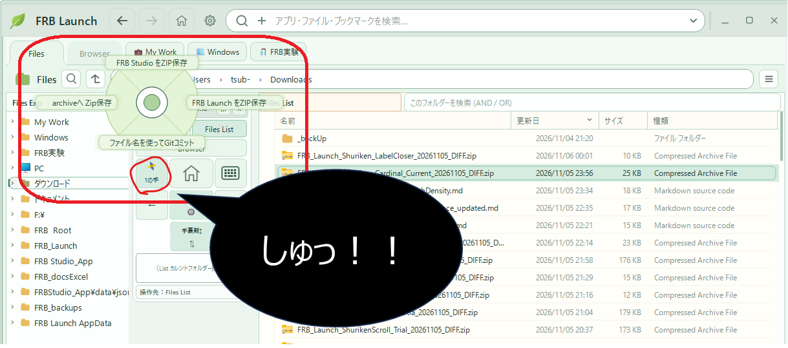
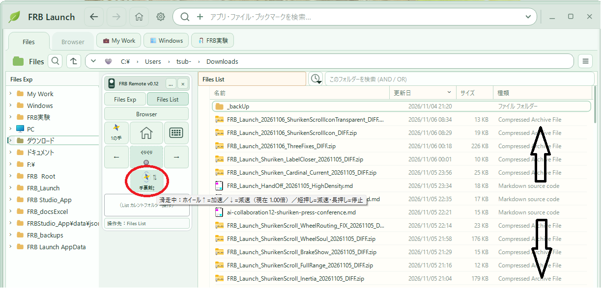

:::message
### はじめに — またしてもFRB研究所の記者会見です（笑）

昨日、パソコンで日本語を入力する「FRB かなフリック」を発表したばかりなのに、もう次の発表です。

今度は**「手裏剣メニュー」と「手裏剣スクロール」**。

どちらも、マウスのボタンを押して、**シュッ！と振って、指を離す**ところから始まります。

ちなみに、仕事の効率がどれだけ改善したかは、まだ分かりません。

ただひとつ言えるのは、**スクロールを減速させるのが、妙に楽しい**ということです。爆笑

※今回も架空の記者会見です。FRB Launch / FRB Remoteは個人開発中の実験ソフトウェアで、操作感に関する話は現時点での個人的な体験です。
:::

■手裏剣メニュー


■手裏剣スクロール



# FRB研究所 緊急記者会見（笑）

*議題：手裏剣メニューと手裏剣スクロールについて*

**所長：** 本日は、新しいマウス操作インターフェース「手裏剣メニュー」と「手裏剣スクロール」を発表いたします。

**記者：** 手裏剣……ですか？

**所長：** はい。「しゅっ！」です。

**記者：** ・・・・。

## 第1部：手裏剣メニューは、どうやって生まれたのか

**記者：** どんなきっかけで、今回発表の手裏剣メニューを思いついたんですか？

**所長：** えっ？ 昨日発表した「かなフリック」のプレビュー表示が、そのままただのメニューに見えたので、そのまま……。

**記者：** ・・・・。

**所長：** かなフリックって、押した瞬間に選択肢が出て、指を動かして、離したら決定するじゃないですか。

**記者：** はい。

**所長：** あれ、別に「かな」である必要ないよね？って。

**記者：** ……それで？

**所長：** メニューにしました。

**記者：** 開発の発想が雑では？

**所長：** 再利用です。

**記者：** 言い方を変えましたね。

---

**記者：** 手裏剣メニューは、どう操作するんですか？

**所長：** FRB Remoteにある「1の手」ボタンを押すと、小さな円形のメニューが現れます。そこでマウスをシュッ！と動かして、離すんです。

**記者：** いくつメニューがあるんですか？

**所長：** 最初は10個ぐらいまでいけるかなと思っていました。

**記者：** 今は？

**所長：** 4個です。

**記者：** なぜ？

**所長：** 疲れました。

**記者：** ・・・・。

**所長：** 左上、右上、左下、右下。これぐらいが、シュッ！とやりやすいんですよ。

**記者：** 具体的には何を実行するんですか？

**所長：** 「FRB StudioをZIP保存」「FRB LaunchをZIP保存」「archiveへZIP保存」、それと「ファイル名を使ってGitコミット」です。

**記者：** ……仕事してるじゃないですか。

**所長：** そうでしょう？

**記者：** 意外です。

**所長：** ・・・・。

## 第2部：なぜ、手裏剣なのか

**記者：** そもそも、なんで手裏剣なんですか？

**所長：** 秀才系の真面目なメガネ女子が「しゅっ」とか言いながら操作してくれたら、面白いかなぁ～って。

**記者：** は？

**所長：** そのときだけ、マウスの動きがにわかに速くなるみたいな（笑）。

**記者：** ・・・・。

**所長：** 社長とかも「しゅっ！」とか言いながら操作してたら面白いじゃないですか。

**記者：** いや、どうでしょう……。

**所長：** 事務所でみんなが「しゅっ！」「しゅっ！」って言い出すんですよぉ～！ 爆笑

**記者：** そんなことになるわけないと思いますが……💦

**所長：** 市役所とか役場に行って、事務員の人たちがみんな「しゅっ！ しゅっ！」って言ってたら、幸せな町だなぁ～ってなりません？？

**記者：** ならないです……。

**所長：** ・・・・。

---

**記者：** で、手裏剣スクロールは？

**所長：** ただの手裏剣つながりです。

**記者：** つながり？

**所長：** 「しゅっ！」ってできることを探したら、スクロールがあったぁーー！ って（笑）。

**記者：** 単純なんですね💦

**所長：** はい。

**記者：** 否定しないんですね。

## 第3部：動いた。でも、つまらなかった

**記者：** スクロールなら、マウスホイールでできますよね？

**所長：** できます。

**記者：** ChromeやExcelにも自動スクロールがありますよね？

**所長：** あります。

**記者：** では、何を作ったんですか？

**所長：** 最初は、ボタンを押したまま上下にマウスを動かすと、スクロール速度が変わるものを作りました。

**記者：** それは、まさに自動スクロールでは？

**所長：** はい。動きました。

**記者：** 成功ですね。

**所長：** でも、つまらなかったんです。

**記者：** ・・・・。

**所長：** なんか、どこかで体験した操作感で。

**記者：** 作る前に気づきませんでした？

**所長：** 動かして、初めて分かりました。

**記者：** ・・・・。

**所長：** そこで気づいたんです。「シュッ！」って、最後は**マウスのボタンから指を離す動作**じゃないですか。

**記者：** まあ、そうですね。

**所長：** だから、離した瞬間に画面が走り出さないと、手裏剣じゃない！

**記者：** 手裏剣の定義が独特ですね。

## 第4部：手裏剣スクロール、発射！

**所長：** というわけで、仕組みを変えました。

**記者：** どう変えたんですか？

**所長：** ボタンを押している間は画面を動かさない。マウスをシュッ！と動かして、**指を離したら発射**です。

**記者：** 発射……。

**所長：** 最初はゆっくり。そこから徐々に加速して、スクロールしていきます。

**記者：** どこまで行くんですか？

**所長：** 基本はスクロール端までです。

**記者：** 4,000行あったら？

**所長：** 4,000行の端まで。

**記者：** 遠すぎません？

**所長：** だから、途中で止めるんです。

**記者：** どうやって？

**所長：** クリックです。

**記者：** 普通ですね。

**所長：** いや、最初はそうだったんですけど、クリックでピタッと止まるだけでは、色気がないんですよ。

**記者：** スクロールに色気が必要ですか？

**所長：** 必要です。

**記者：** ・・・・。

## 第5部：妖艶さの正体は「減速」だった

**所長：** そこで、短くクリックしたら減速、長押ししたら完全停止にしました。

**記者：** ああ、ブレーキですね。

**所長：** はい。一回カチッと押すと……スーーッ……。

**記者：** はい。

**所長：** もう一回カチッと押すと……ス…………。

**記者：** ……はい。

**所長：** **これが、めっちゃ楽しいんですよぉーーーー！！** 爆笑

**記者：** ・・・・。

**所長：** 最初は、色を変えたり、光らせたりして妖艶さを演出しようかと思ったんです。

**記者：** 妖艶さ……。

**所長：** でも、いらなかった。クリックするたびにスクロールの動きが変わる。**自分の手で減速を操っている感じ自体が、もう妖艶**なんです。

**記者：** その感想を業務報告に書くんですか？

**所長：** 書きます。

**記者：** ・・・・。

---

**記者：** それで、中央の「ぐりぐり」ボタンはどうなったんですか？

**所長：** ふだんは一覧のカレント位置を動かす操作に使っています。

**記者：** はい。

**所長：** でも、スクロールが滑走している間は、同じ方向へぐりぐりすると加速、逆方向なら減速できたら面白いんじゃないかって。

**記者：** ……まるで乗り物ですね。

**所長：** そうなんです。画面を運転するんです。

**記者：** 実用性は？

**所長：** 今、実験中です。ホイール操作の届き方なども調整しています。

**記者：** よかった。まだ実験だったんですね。

**所長：** いつだって実験です。

## 第6部：いったい何の研究所なんですか？

**記者：** ちょっと確認したいんですが、FRB研究所って何の研究をしているところでしたっけ？

**所長：** FRB。**Fishing Rod Benchmark**です。

**記者：** 釣り竿？

**所長：** ロッドの「感度」を振動として測定し、FFT解析などで比較・可視化して、共通言語にしようというエンターテイメント研究です。

**記者：** エンターテイメント研究？？

**所長：** 喜びや楽しみ、気晴らしを提供する活動やサービスの総称をエンターテイメントといいます。（By Google）

**記者：** ・・・・。

**記者：** ……釣り竿の研究所が、なぜエクスプローラーを動かしているんですか？

**所長：** ロッドもマウスも、**人間が入力したときに、どう応答するか**が面白いんですよ。

**記者：** ……なるほど？

**所長：** 振動の伝わり方を眺めていたら、今度はスクロールの加速と減速を眺めていました。

**記者：** 研究対象が広がりすぎでは？

**所長：** まあ、楽しいので。

**記者：** ・・・・。

---

**記者：** 最後に、FRB Launchで目指しているものを教えてください。

**所長：** もともとは、マウスの移動距離を減らしたかっただけなんです。

**記者：** それが今では？

**所長：** 無機質な仕事道具であるエクスプローラーに、魂を吹き込んで、エンターテイメントの舞台に立たせようとしています。

**記者：** 壮大な話になりましたね。

**所長：** シュッ！で走り出して、カチッ！で色っぽく減速するんですよ。

**記者：** その「色っぽく」は必要ですか？

**所長：** 必要です。

**記者：** ほかには？

**所長：** ・・・・。

**記者：** ありがとうございました。

**所長：** しゅっ！

---

## 記者会見のあとに — 仕事道具に「魂」を吹き込むとは

今回の流れを振り返ると、最初から手裏剣スクロールを計画していたわけではありません。

```text
マウスをあまり動かしたくない
    ↓
FRB Remoteの「ぐりぐり」を作る
    ↓
フリック操作から「FRB かなフリック」が生まれる
    ↓
かなフリックのプレビューが、ただのメニューに見える
    ↓
「手裏剣メニュー」誕生
    ↓
「しゅっ！」でほかに何ができる？
    ↓
「手裏剣スクロール」誕生
    ↓
動いた。でも、つまらん（笑）
    ↓
離した瞬間に発射する方式へ
    ↓
短押しで減速、長押しで停止
    ↓
減速、楽しいぃーーーー！！（爆笑）
```

技術的に特別な発明をしたという話ではありません。フリック、慣性スクロール、加減速の制御には先行する仕組みがありますし、今回の試作はまだ操作性を検証している途中です。

でも、少なくとも自分自身の体験として、ひとつ面白いことが起きました。

**機能が動いただけでは、楽しくなかった。**

**動いている画面の変化に、自分の手で介入できたとき、急に楽しくなった。**

画面がきれいに装飾されているからではありません。マウスを動かすたび、クリックするたび、目の前のものが応答してくれる。その応答に表情がある。

もしかすると、仕事道具に魂を吹き込むというのは、そういうことなのかもしれません。

> **仕事道具に魂を吹き込むとは、道具に人間らしい外見を与えることではなく、人間が関わり続けたくなる応答を与えること。**

もちろん、便利さや安全性を犠牲にしてまで演出を増やしたいわけではありません。目指しているのは、マウスだけで短い距離を操作しながら、仕事ができて、つい笑ってしまう体験です。

「完成した答えよりも、答えからこぼれ落ちた違和感を大切にする。」

今回の「動いたけど、つまらん」は、まさにそんな違和感でした。

そして最大の研究成果は、今のところ——

**「手裏剣スクロールの減速を、何度もクリックして楽しんでいる人が、少なくとも一人いる」ことの確認です。**

**記者：** ほかには？

**所長：** ・・・・。

（爆笑）

### 追記：結局、ポジティブフィードバックなのかもしれない（笑）

この記事を書き終えて、ふと思ったことがあります。

> **人間が関わり続けたくなる応答を与えること。**

これって、パソコンの話だけじゃないんじゃないか？

**上司と部下、AIと人間、PCと人間。**

どの関係でも、相手の働きかけに対して「何が変わったのか」が伝わることが大切なのかもしれません。

- 部下が提案したら、上司が受け止めて判断を返す。意見が違っても、ちゃんと理由が返ってくる。
- 人間がAIに「なんか違う」と言ったら、AIがその違和感を手がかりに成果物を変える。
- 人間がマウスで「シュッ！」とやったら、画面が走り出す。カチッ！と押したら、色っぽく減速する（笑）。

大切なのは、ただ「いいね！」と褒めることでも、何でも言うとおりにすることでもない。

**自分の働きかけが、相手の意味ある変化につながったと実感できること。**

その変化が嬉しいから、また関わりたくなる。関わるから、また新しい変化が生まれる。

こういう**建設的なフィードバックの循環**が、仕事にもAI協働にも、そして道具との付き合い方にも必要なのかもしれません。

もちろん、制御工学でいう「正のフィードバック」が常に良いという話ではありません。暴走することもありますから（笑）。ここで言いたいのは、**次の働きかけを生む、意味ある応答**のことです。

---

**記者：** 所長、手裏剣スクロールから、ずいぶん話が大きくなりましたね。

**所長：** 上司と部下も、AIと人間も、PCと人間も。結局はポジティブフィードバックが大切なんじゃないかと。

**記者：** なるほど。今日は珍しく、いいことを言いましたね。

**所長：** ちょっとええこと言うたなぁ～俺。爆笑

**記者：** 自分で言わなければ、もっとよかったんですけどね……。

**所長：** ・・・・。

---

### 関連記事・ソース

- [AI協働：パソコンでかなフリックを作った話 — ほかには？（笑）](https://zenn.dev/frb_tamasub/articles/ai-collaboration11-frb-kana-flick-press-conference)
- [AI協働：FRB Launch続報 — マウスホイールぐりぐりが魔法になった話（笑）](https://zenn.dev/frb_tamasub/articles/ai-collaboration07-frb-launch-wheel-experience)
- [AI協働：FRB Launch続々報 — マウスを動かしたくなくて、リモコンが生まれた話（笑）](https://zenn.dev/frb_tamasub/articles/ai-collaboration08-frb-launch-remote-experience)
- [FRB Launch ソース（GitHub）](https://github.com/tamasub/FRB/tree/main/tools)

※FRB Launch / FRB Remoteは個人開発・検証中です。ここで紹介した機能や操作感は、開発時点の試作品に関するものです。

Fishing Rod Benchmark［FRB］By tamasub
