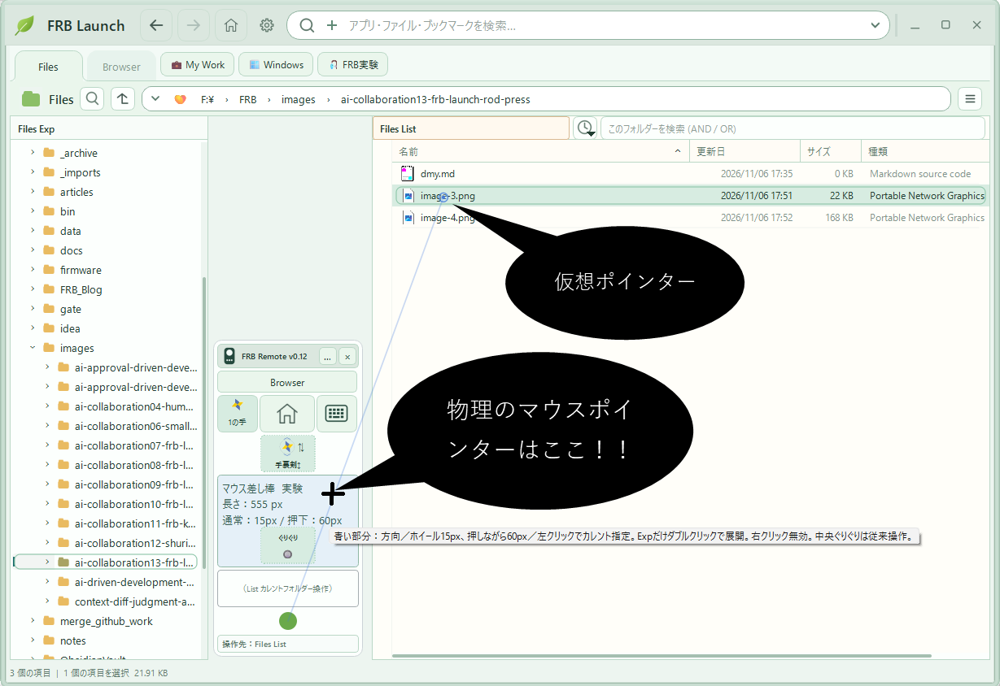
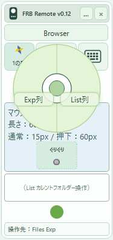
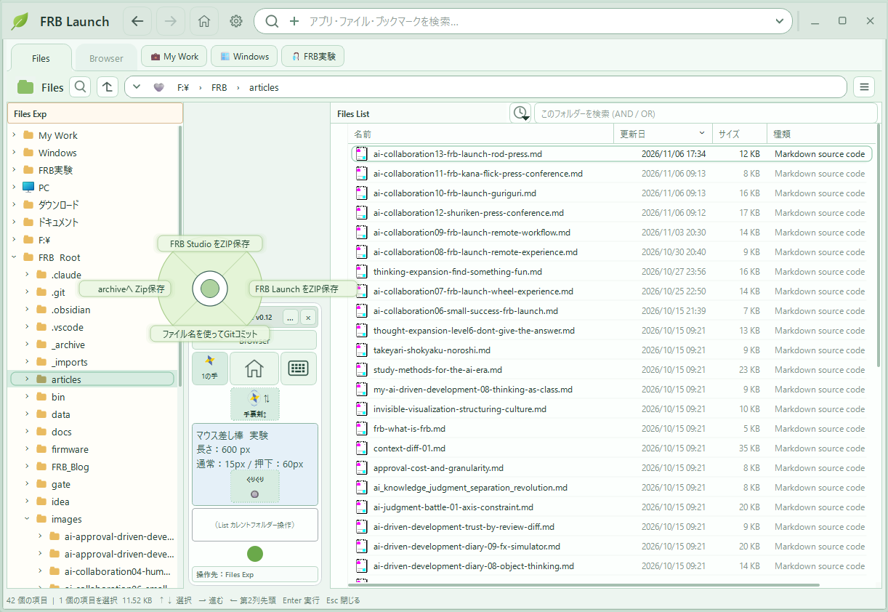
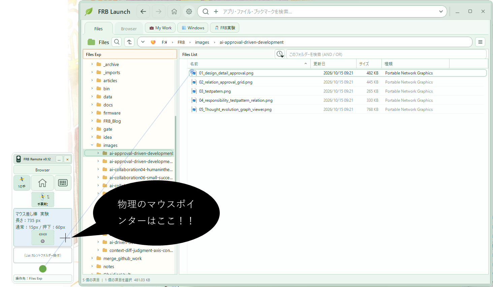

# AI協働：FRB Launch — 新型ポインティングふぅ装置「マウス差し棒」発表！💦

**〜たった2cmのマウス移動をなくすために、我々は何をしているのか？〜**

FRB研究所はこのたび、画面上に伸びる謎の棒、**「マウス差し棒（Mouse Pointer Rod）」**を発表した。

小さな操作エリアで棒の角度を決め、ホイールをぐりぐりすると先端が伸び縮みする。現在はFRB LaunchのFiles List／Files Expを、実際のマウスカーソルを移動させずに選択できる。

なぜ作ったのか。何の役に立つのか。そもそも研究所は何を研究しているのか。

疑問が多すぎるため、緊急記者会見を開催することになった。

※以下は開発の顛末を題材にした**架空のコント風記者会見**です。技術的な補足は記事末にあります。

---

■FRB Launch マウス差し棒

## 記者：開発のきっかけを教えてください

**記者：** 本日は、新しく開発された「マウス差し棒」についてお話を伺います。まず、開発のきっかけを教えてください。

**所長：** 手裏剣メニューがポケモンボールに見えたことです。

**記者：** ……はい？

**所長：** うちのFRB Launchには、手裏剣メニューという機能があります。ボタンの上でほんの少しマウスをフリックするだけで、目的のメニューを選択できるんです。

**記者：** なるほど。それがポケモンボールに見えたと。

**所長：** そうです。そして、あることに気づいたんですよ。

**記者：** 何でしょう？

**所長：** テコの原理です！

**記者：** あぁーー！ 小さな動きが、大きな動きに変換されているということですね？

**所長：** その通り！ だったら、もっと露骨にテコの原理を使ってしまえぇーーー！！ という発想です。

**記者：** ……それで、差し棒？

**所長：** そうです！ マウスの小さな移動で棒の角度を変え、画面上の遠くの場所を指し示すんです！

**記者：** なるほど。棒が長ければ、少し角度を変えるだけで先端が大きく移動しますね。

**所長：** わかっていただけましたか！！

**記者：** ただ、厳密にはテコの原理というより回転運動の幾何学では……。

**所長：** 次の質問をお願いします。

---

## 記者：そもそも差し棒なんて要りますか？

**記者：** 率直にお聞きします。差し棒って、本当に必要なんでしょうか？

**所長：** 要ります！！

**記者：** どうしてですか？

**所長：** だって、マウスホイールをぐりぐりしたら棒が伸びたり縮んだりするんですよ？？

**記者：** ……はぁ。

**所長：** めっちゃ気持ちいいんですよ？？

**記者：** 気持ちいい……。

**所長：** やってみます？？

**記者：** いやぁ～。ちょっと遠慮しておきます……。

**所長：** しかも！！ 加速装置までついているんです！！

**記者：** 加速装置？

**所長：** 「かそくそぉぉーーーっち！！」

**記者：** おぉ！ 音声認識で加速するんですか！？

**所長：** いえ。マウスの左ボタンを押しながらホイールを回すだけです。

**記者：** ……今、何のために叫んだんですか？

**所長：** 雰囲気を盛り上げようと思いまして。

**記者：** 仕様の説明で雰囲気を盛らないでください。

**所長：** 通常は15px、加速時は60pxずつ伸縮します！

**記者：** 4倍速ですね。

**所長：** そう！！ 4倍です！！ すごいでしょう！？

**記者：** 数字はわかりました。声量を4分の1にしてください。

---

## 記者：それ、普通のマウスじゃダメなんですか？

**記者：** ちなみに所長、以前、普通のマウスで画面の上から下までポインターを移動させる実験をされたそうですね。

**所長：** はい！

**記者：** 物理的なマウスの移動距離は、どれくらいだったんですか？

**所長：** 2cmです。

**記者：** ……2cm？

**所長：** そうです。

**記者：** たった2cm？

**所長：** その通りです！！

**記者：** それで、このマウス差し棒を開発したと？

**所長：** その2cmをなくしたかったんです！！

**記者：** **2cmぐらい動かしてくださいよ！！**

**所長：** そういう問題じゃないんです！！

**記者：** どういう問題なんですか！？

**所長：** やってみたかったんです！！

**記者：** ……ようやく正直な回答が出ましたね。

---

## 記者：ほかに簡単な方法がありませんか？

**記者：** ひとつ気になっていることがあります。

**所長：** 何でしょう？

**記者：** FRB Launchのリモコンって、本体の外に出して使えますよね？

**所長：** はい。

**記者：** でしたら、リモコンを外へ移動して、Files Exp列とFiles List列が隣り合うように配置すれば……。

**所長：** ……。

**記者：** そもそも差し棒なんて必要ないんじゃないですか？

**所長：** ……。

**記者：** 所長？

**所長：** **うちの研究所、潰れちゃいます。言わないでっ💦**

**記者：** いや、合理的な代替案を提示しただけなんですが……。

**所長：** その合理性が、研究所を潰すんです！！

**記者：** 研究所の経営、大丈夫ですか？

**所長：** 今のところ売上ゼロなので、経営上の問題は発生していません。

**記者：** それは問題が発生していないんじゃなくて、経営が発生していないんですよ。

---

## 記者：そもそもFRB研究所とは？

**記者：** ここで根本的な確認をさせてください。

**所長：** どうぞ！

**記者：** FRB研究所って、何を研究しているところでしたっけ？

**所長：** FRB。Fishing Rod Benchmarkです！

**記者：** 釣り竿の感度を数値化する研究ですよね？

**所長：** そうです！

**記者：** ……今日の発表と、全く関係がない気がするんですが。

**所長：** 気のせいです！！

**記者：** どういうことでしょう？

**所長：** Fishing Rodとは、いわゆる大自然を人間の身体、特に「手」で感じるための道具です。

**記者：** はぁ……。

**所長：** 我々は、釣り竿を通じて伝わるわずかな振動を、人間がどう感じ取るのか研究してきました。

**記者：** ええ、それは存じています。

**所長：** そして今回のマウス差し棒も、人間の手が生み出すわずかな動きから、新しい体験を引き出そうとしているんです。

**記者：** ……なるほど。

**所長：** つまり、我々が研究しているのは単なる釣り竿ではありません。

**記者：** ほう。

**所長：** **人間の手と世界との接点なんです！！**

**記者：** おぉーーー！！ なんだか急に立派な研究に聞こえてきました！！

**所長：** そうでしょう！！

**記者：** では、今日発表された「マウス差し棒」もFishing Rodの一種ということでしょうか？

**所長：** その通りです！！

**記者：** ……魚は釣れるんですか？

**所長：** 釣れません。

**記者：** 海では使えるんですか？

**所長：** 使えません。

**記者：** 釣り竿なんですか？

**所長：** 棒です。

**記者：** ……。

**所長：** ……。

---

## 記者：最後に、今後の展望をお願いします

**記者：** では最後に、このマウス差し棒を今後どうしていきたいですか？

**所長：** まだわかりません。

**記者：** えっ？

**所長：** そもそも、誰がこんな機能を使うのか、我々にもわかっていないんです。

**記者：** ……それを記者会見で発表しているんですか？

**所長：** はい！！

**記者：** ものすごい研究所ですね。

**所長：** ただ、ひとつだけ言えることがあります。

**記者：** 何でしょう？

**所長：** 最初は、マウスの小さな動きを大きく変換できたら面白いと思っただけでした。

**記者：** はい。

**所長：** でも、実際に触ってみると、思っていた操作が使いにくかったり、逆に予想もしなかった操作が気持ちよかったりするんです。

**記者：** なるほど。

**所長：** そういう小さな発見を積み重ねているうちに、今まで考えたこともなかったUIが生まれるかもしれない。

**記者：** ……それは、なかなか素敵な話ですね。

**所長：** **完成した答えよりも、答えからこぼれ落ちた違和感を大切にする。**

**記者：** おぉ……。研究所としての信念ですね。

**所長：** はい。

**記者：** では、マウス差し棒が世界中で使われる日も来るかもしれませんね。

**所長：** もちろんです！！

**記者：** 最後に、現時点での最大の成果を教えてください。

**所長：** ぐりぐりすると、棒が伸びます！！

**記者：** **結局そこかぁぁぁーーー！！**

---

## 技術メモ：いまの「マウス差し棒」は何をしているのか

笑い話のように聞こえるけれど、実装上は次のようなUI実験をしている。

- **照準：** 小さな操作エリア内のマウス位置から角度を計算し、画面に差し棒を描画する。
- **伸縮：** 操作エリアのマウスホイール操作で15pxずつ、左ボタンを押しながらなら60pxずつ長さを調整する。
- **選択：** 棒の先端座標から、FRB Launch自身のFiles List／Files Expの対象行を取得して選択する。選択のためにOSのマウスカーソルを移動させない。
- **操作の分担：** 照準エリアでは対象を狙ってカレントを決め、ぐりぐりボタン側では従来のカレント操作を使う。
- **控えめな存在感：** 照準エリアへの短い通過では棒を出さず、一定時間滞在したら薄い線で表示。操作エリアから出ると隠す。

実験の現時点で対象にしているのは、主に**FRB Launch内部のQt UI**。ほかのアプリやCitrixなどで一般的な仮想マウスとして動作することを示したものではない。

また、普通のマウスより速い、負担が少ない、と証明できたわけでもない。そこは、これから使いながら確かめる。

なぜこんなUIを作ったのか？

**「できるかどうか」より先に、「触ったらどう感じるか」を知りたかったから。**

---

追伸：
まだとても、「新型ポインティング装置」と言えるようなものでは残念ながらございません。悪しからずご了承ください💦

*FRB研究所では、引き続き「誰が使うのかよくわからないけれど、なぜか使ってみたくなるUI」の研究を続けてまいります。*

*なお、本研究によって釣果が向上することは一切保証しておりません。*

**FRB研究所 所長**

**本日の釣果：ボラ一匹。**

---

- [【動画】マウス差し棒を動かしてみた！！](https://youtu.be/N9g9SsxpcQ4)

---

### 関連記事・ソース

- [AI協働：FRB Launch — エクスプローラーに魂を吹き込む手裏剣の話 — しゅっ！（笑）](https://zenn.dev/frb_tamasub/articles/ai-collaboration12-shuriken-press-conference)

- [FRB Launch ソース（GitHub）](https://github.com/tamasub/FRB/tree/main/tools)

※FRB Launch / FRB Remoteは個人開発・検証中です。ここで紹介した機能や操作感は、開発時点の試作品に関するものです。

Fishing Rod Benchmark［FRB］By tamasub
