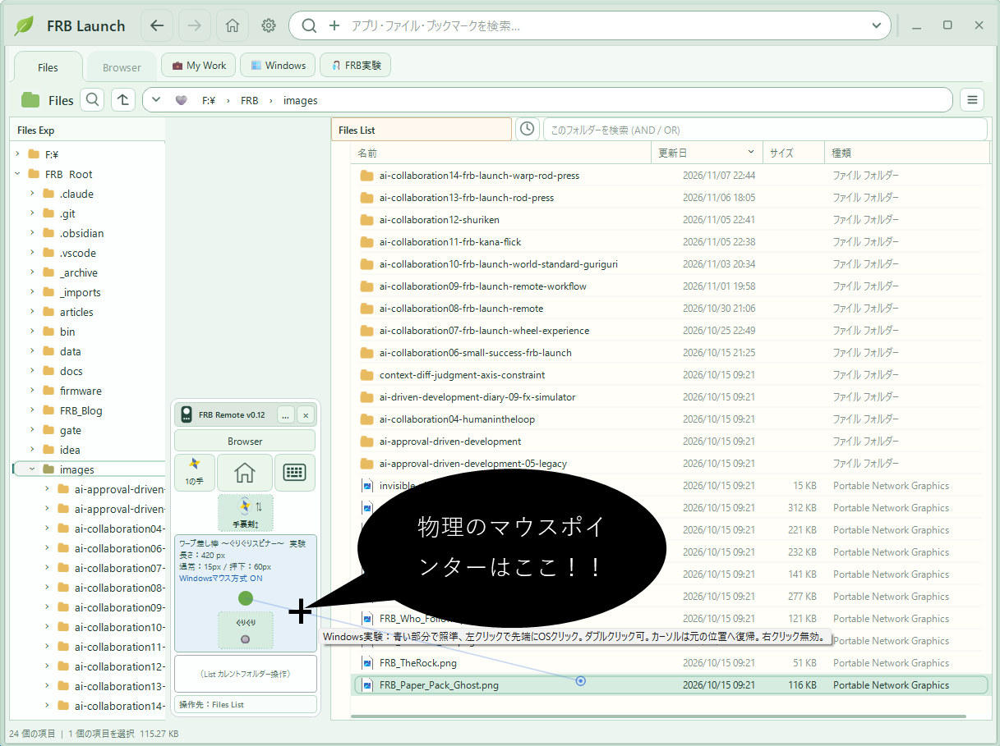

## はじめに — 昨日の差し棒が、もう古くなった（笑）

昨日、FRB研究所は新型ポインティングふぅ装置「マウス差し棒」を発表した。

小さな青い操作エリアでマウスを動かすと、画面に長い棒が現れる。ホイールをぐりぐりすると伸び縮みする。先端で離れた場所を指し、クリックまでできる。

「たった2cmのマウス移動をなくしたい」という、実に壮大な研究だった（笑）。

そして翌日。

**マウス差し棒が、もう新型ではなくなった。**

本日の発表は、その名も——

**「ワープ差し棒」！ 通称「ぐりぐりスピナー」！！**

※以下は、実際の試作と体験を題材にした**架空の記者会見**です。操作性の評価は現時点では開発者個人の感想であり、一般的な性能を実証したものではありません。

---

## FRB研究所・緊急記者会見 第5回（笑）

### 昨日と何が違うんですか？

**記者：** 所長、昨日「マウス差し棒」を発表したばかりでは？

**所長：** はい。本日は、さらに進化した「スマート マウス差し棒」を発表します！！

**記者：** 昨日はスマートじゃなかったんですか？

**所長：** 昨日は普通の差し棒です。今日は**すまぁーーーーーと**な差し棒です！！

**記者：** ……説明をお願いします。

**所長：** 昨日の差し棒は、ホイールで長さが伸び縮みするんです。

**記者：** それは昨日聞きました。

**所長：** ところが伸ばしているとき、心の中では「上に行ってくれぇーー！」って思っていたんですよ。

**記者：** はい。

**所長：** 縮めるときは「下に行ってくれぇーー！」って。

**記者：** ……つまり？

**所長：** **伸び縮みさせたかったんじゃない。先端を上下に動かしたかったんです！！**

**記者：** 最初からそう言ってください！！

### 実マウスまで勝手に動くんです

**所長：** そこで、ホイールを回すと、棒の先端が横にズレず、まっすぐ上下へ移動するようにしました。

**記者：** でも差し棒って、実マウスの位置で角度が決まるんでしょう？　先端だけ動かしたら次のマウス操作で飛びませんか？

**所長：** そこです！！　**実マウスカーソルも、差し棒の線上へ自動移動させたんです！！**

**記者：** マウスを人間が動かさなくても、角度が変わる？

**所長：** そうなんです。青い操作エリアの中で、カーソルを新しい角度へ連れていきます。

**記者：** それは確かにスマートですね。

**所長：** **すまぁーーーーーーーーーと！！！**

**記者：** 一回で分かりました！！

### 緑の点を引っ越しさせただけなのに

**所長：** ところが、これが気持ちよく動くようになると、また違和感が出てきたんです。

**記者：** 今度は何ですか？

**所長：** 差し棒の固定起点。あの緑の点です。もっと上に置きたくなりまして。

**記者：** それで？

**所長：** 青い操作エリアを少し縦長にして、起点を「ぐりぐり」ボタンの真上へ移しました。

**記者：** それだけ？

**所長：** それだけです。

**記者：** 結果は？

**所長：** **画面の下まで指せるようになりましたぁぁぁーーー！！**

**記者：** ……普通のマウスでも下まで届きますよね？

**所長：** **研究所を潰す気ですか！！！**

### そして、ぐりぐりしなくなった

**記者：** では、操作はずいぶん快適になったんですね。

**所長：** ここからが本日の大発見です！！

**記者：** まだあるんですか？

**所長：** 起点を上に移したら、実マウスをほんの少し動かすだけで、差し棒の先端が画面を**ワープするように移動**するようになったんです！！

　[動画見てみます？実マウスの動きが少ないのに仮想ポインター（先端）がぽんぽん動いていることに注目して見てね💦（Youtube動画）](https://youtu.be/6oC4ncvjLik)

**記者：** ほう。

**所長：** Launchのエクスプローラーなら、回転するだけで遠くの項目を次々と指せる。**今では、基本ぐりぐり無しで操作できるんです！！**

**記者：** ……ぐりぐりスピナーなのに？

**所長：** 長さを調整したいときだけ、ぐりぐりします！！

**記者：** **ぐりぐりを進化させた結果、ぐりぐりが要らなくなったんですか！？**

**所長：** そうなんですぅぅぅーーー！！（爆笑）

---

## なぜ起点を近づけると「ワープ」するのか

ここからは少しだけ、まじめな話。

差し棒の固定起点を **O**、青いエリア内の実マウスカーソルを **C**、差し棒先端を **P** とする。

差し棒は、原則として **O → C → P** が同じ直線上に並ぶ。

起点 O からカーソル C までの距離が短いと、カーソルのわずかな動きでも棒の角度が大きく変化する。先端 P が遠くにあるほど、その変化は画面上で大きな移動になる。

小さな角度変化を考えれば、先端の横方向の移動量はおおむね、

**先端の移動量 ≒ （起点から先端までの距離 ÷ 起点からカーソルまでの距離）× カーソルの横方向の移動量**

となる（差し棒にほぼ直角の微小な移動を想定した近似）。

つまり、起点を実カーソルに近づけると、**操作感度が上がる**。

従来は、これが怖かった。

カーソルが少しブレただけで棒の方向が大きく変わる。だから、起点からカーソルまでの距離をある程度確保して、安定させたいと思っていた。

ところが、スマート化によって事情が変わった。

ホイールで先端を上下させると、**必要な角度をシステムが計算し、実カーソルも差し棒の線上へ自動追従**する。

人間がマウスを細かく動かして角度を合わせる必要が減ったのだ。

**ブレやすいという幾何学的性質が消えたわけではない。ブレの影響を受けやすい手動操作そのものが減った。**

その結果、以前は避けていた起点近くの高感度領域が、今度は「高速移動に使える領域」になった。

**制約を克服したというより、制約が必要だった前提が変わってしまった。**

ここが、今回いちばん面白かったところだと思う。

---

## ただし、万能ではありません（笑）

**記者：** それなら普通のマウスは、もう要らないのでは？

**所長：** いやぁ、それがですね……。

**記者：** はい。

**所長：** ChatGPTのWeb画面を操作してみたら、めっちゃストレスでした！！

**記者：** えっ！？

**所長：** ボタンや入力欄があちこちにあるので、棒の長さを何度も変えないと届かないんです。

**記者：** なるほど。回転が得意でも、起点からの距離が頻繁に変わる画面は苦手なんですね。

**所長：** そういうことです！！

**記者：** では、Windowsのマウスポインター速度を上げるのと、どっちがいいんですか？

**所長：** ………………。

**記者：** 所長？

**所長：** **それを聞かれると研究所の存続が危うくなります！！💦**

（笑）

現時点で、ワープ差し棒が一般のマウスより速い、精度が高い、疲れにくいという客観的な比較結果はない。

ただ、LaunchのFiles Listのような、項目がまとまって並ぶ画面では、実マウスの小さな動きで広い範囲を指せることが、とても気持ちよく感じられた。

一方、長さ調整が頻繁に必要な画面では、明確にストレスを感じた。

**道具の良し悪しは、操作対象の配置との相性によって変わる。**

今のところ、それが実験結果だ。

---

## 今日の本当の研究成果は何だったのか

**記者：** 所長。結局、今回の研究で何が分かったんでしょうか？

**所長：** 予想していなかった操作感に出会えたんです。

**記者：** ……それだけですか？

**所長：** それが、すべてです。

最初から「ワープするポインターを作ろう」と考えていたわけではない。

「棒を伸ばすとき、上へ行ってほしい」という小さな違和感があった。

そこで先端を垂直移動させた。すると実カーソルの自動追従が必要になった。それができるようになると、起点の位置を変えてみたくなった。

**その結果、思ってもみなかった高速な回転操作に出会った。**

完成形を最初に設計していたら、この順番は生まれなかったかもしれない。

AIに実装を手伝ってもらい、人間が触って違和感を返す。新しくできたものを触って、また別の発想が生まれる。

私が取り組んでいる「思考拡張」とは、こういうことなのかもしれない。

> **思考拡張とは、思いついたことをAIに実現させるだけではない。実現したものに触れることで、それまで思いつくことすらできなかった次の発想に出会うことである。**

**記者：** なるほど。それはなかなかいい話ですね。

**所長：** はい。

**記者：** では、ワープ差し棒の最大の成果は？

**所長：** **ぐりぐりしなくても、ぐりぐりスピナーが使えるようになったことです！！**

**記者：** **結局そこかぁぁぁーーー！！！**

---

## 技術メモ：第13弾から変わったこと

- **操作方式：** 青いエリア内の実カーソル位置から、固定起点に対する差し棒の方向を決める。
- **スマート上下移動：** 青いエリアでホイールを回すと、先端の横位置をなるべく保ちながら上下へ移動。角度と差し棒長を逆算する。
- **実カーソル追従：** 新しい角度に沿って、実カーソルも青い操作エリア内へ自動移動。操作エリアの境界では無理に追従させない。
- **起点変更：** 緑の起点を「ぐりぐり」ボタンの真上へ移し、青い操作エリアを縦に拡張。
- **Windowsマウス方式：** 差し棒の先端をクリック位置として扱う実験モードにより、FRB Launchの外のアプリにも操作を試せるようになった。
- **得意／不得意：** 一覧のように回転で狙いやすい配置とは相性がよい。一方、頻繁な長さ調整が必要な画面には不向き。

いずれも実験中の仕様であり、操作感についての評価は主観的なもの。普通のマウスとの定量比較は今後の課題とする。

---

### 追伸：Geminiちゃんに「いい感じに」を禁止されたら（笑）

この日の別の出来事として、Google検索から出会ったGeminiに、私のAI駆動開発手法を解説してもらった。

驚くほど本質を捉えた紹介のあと、具体的なテクニックの説明では突然、**「AIにいい感じによろしくと言っては駄目！」というルールが登場した（笑）。

いやいや、私から「いい感じによろしくぅ～」って言葉を取り上げたら、今日の差し棒も生まれていない。

**探索では「いい感じに」を大切にする。保証すべきことはExpected／Actual／Diffで確かめる。**

この境界を混ぜないことも、AI協働の実験で繰り返し学んでいることだ。

なお、GeminiちゃんはFRB協働研究チームの正式メンバーである。ChatGPTがうっかり新規採用しようとして、あとから所長に注意されたのは、ここだけの話である。爆笑

---

**FRB研究所 所長**

**本日の釣果：ボラ一匹。**

---

#### 関連記事・ソース

- 前回：AI協働・記者発表 第13弾「マウス差し棒」発表（`ai-collaboration13-frb-launch-rod-press.md`）
- [FRB Launch ソース（GitHub）](https://github.com/tamasub/FRB/tree/main/tools)

※本記事は個人の試作・体験を記録したものです。製品としての一般的な性能や操作性を保証するものではありません。

Fishing Rod Benchmark［FRB］By tamasub
