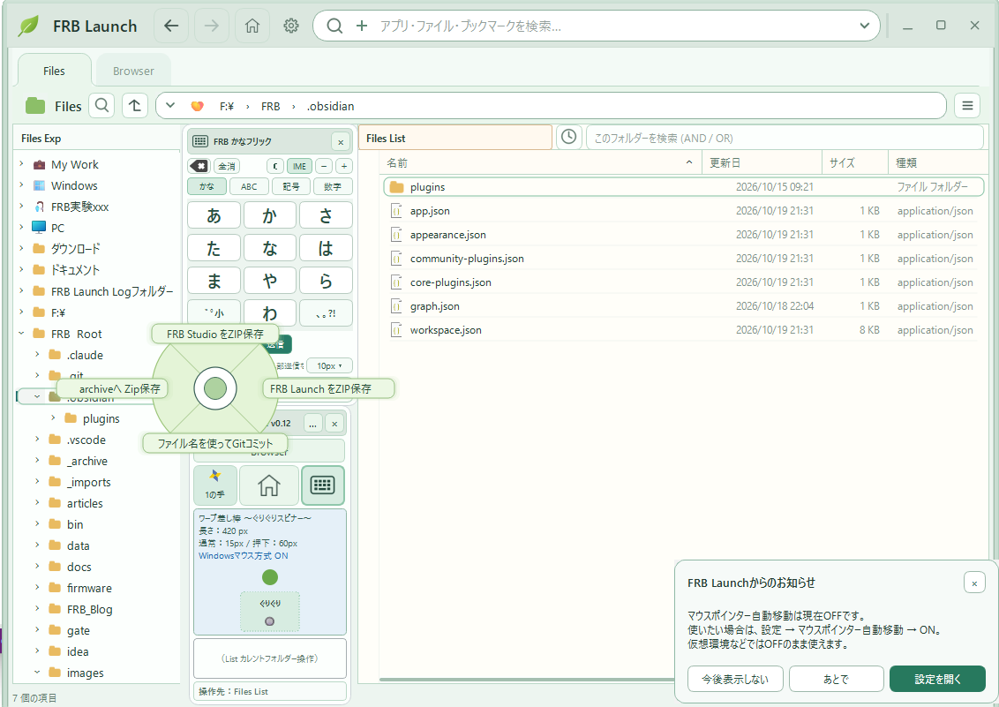

## はじめに — 公開準備をしていたはずなのに（笑）

前回の記者会見では、「マウス差し棒」を進化させた結果、**ぐりぐりしなくても使える「ぐりぐりスピナー」**が誕生した。

あれからFRB Launchは、公開に向けて配布ファイルや画面を整理している。

機能を減らしたり、メニューを隠したり、フォルダーアイコンを一つ消したり。

……地味である。

ところが、その裏で、マウスホイールの「ぐりぐり」が妙な進化を遂げていた。

本日、FRB研究所は**二つの新しい操作方式**について記者会見を開くことにした。

※以下は、実際の試作・操作体験を題材にした**架空の記者会見**です。名称に「世界標準規格」とありますが、もちろん正式な国際標準ではありません。今のところ、所長の野望です（笑）。

---

## FRB研究所・緊急記者会見 第6回（笑）

### まずは、名前が長すぎます

**記者：** 所長、本日はどのような発表でしょうか？

**所長：** まずは、**「FRB ぐりぐり追従スクロールハイブリッド方式 With 手裏剣スクロール」**を発表いたします！！

**記者：** ……まずは？

**所長：** はい。今日は二件ございます。

**記者：** 一件目の名前だけで、すでに会見の半分が終わった気がします。

**所長：** 略称は**「FRB ハイブリッド方式」**です。

**記者：** 最初からそっちでお願いします。

**所長：** そうすると、正式名称を考えた私の努力が報われないじゃないですか。

**記者：** ……で、ハイブリッド方式というのは、前にも聞いたような？

**所長：** そうです。以前のハイブリッド方式へ、先日発表した手裏剣スクロールを**いい感じにマイルドブレンド**しました。

**記者：** 何と何を混ぜたんですか？　ブレンド比率は？

**所長：** ……質問まで急に意味不明になってきましたね。私のせいですか？💦

**記者：** たぶん、ほぼ全部そうです。

### 実は代名詞がありました — WAN

**所長：** まず、FRB Launchの代名詞をご説明しましょう。

**記者：** 代名詞があったんですか！？

**所長：** はい。**Wheel Adaptive Navigation、略してWAN！**

**記者：** WAN？　ネットワークの話ですか？

**所長：** 違います。ぐりぐりの話です。

**記者：** IT業界、略語がもう足りませんね……。

**所長：** ファイル一覧の上でホイールをぐりぐりすると、項目を移動できる。さらに「マウスポインター自動追従」をONにすると、**選択位置に合わせて実際のマウスポインターも移動**してくれるんです。

**記者：** ということは、ぐりぐりして目的の行へ行ったら、マウスをそこまで運び直さずクリックできる？

**所長：** **そうぉーーーーーーーっち！！**

**記者：** それ、最初に教えてくださいよ！　めっちゃ便利そうじゃないですか！

**所長：** 言ってなかったっけ？

**記者：** 本日一番重要な説明を忘れていた可能性があります。

**所長：** ……まぁ、そういうこともあるでしょう（笑）。

ただし、自動追従は環境によって正常に使えない可能性があります。仮想環境なども想定しているので、**初期設定はOFF**です。使える環境で、利用者が明示的にONにする方式にしています。

**記者：** なるほど。OFFの人は、選択したあとマウスを移動させないといけないんですね。

**所長：** そこで朗報です！！

### ついに、左手さんの参加が認められました

**所長：** 今回の思考拡張実験、これまで左手さんには参加をご遠慮いただいていました。

**記者：** ……左手さん？

**所長：** マウスだけでどこまで操作できるかの実験ですからね。

**記者：** 左手にも人権はあると思いますが。

**所長：** ところが、GPT先生から特別にお許しが出ました。

**記者：** 何の許可ですか？

**所長：** **ぐりぐりでカレント行を動かしたあと、左手さんにEnterキーを押していただいても構いません！！**

**記者：** ……それ、普通のキーボード操作では？

**所長：** わざわざマウスを動かすより楽なら、それでいいじゃないですかぁ〜（笑）。

**記者：** 最初から左手さんを呼べばよかったのでは？

**所長：** **研究所の存在意義を根本から揺さぶる質問はご遠慮ください！！**

**記者：** またそれですか……。

**所長：** ちなみにFRB Remoteを使えば、もっとマウス主体で操作できます。「ぐりぐり」ボタン上でホイールを回して目的の項目へカレントが自動移動。そのまま「ぐりぐり」ボタン上でクリック、ダブルクリック、右クリックまでできるんです。

**記者：** えぇーーー！　そんな機能があったんですか！？

**所長：** 第1回の会見で言ってなかったっけ？

**記者：** 所長、これまで会見で一番説明してきたのは**世界標準規格の野望**ですよ。

**所長：** ……あれ？💦

### ハイブリッドとは、相手がこっちに来ることだった

**記者：** では、ようやくハイブリッドの中身を聞かせてください。

**所長：** ファイル一覧って、二つの動き方があるんです。

一つは、ホイールに合わせて**一覧そのものを高速スクロール**する動き。

もう一つは、スクロールバーの端や、そもそもスクロールできない場面で、**カレント行を一行ずつ動かす**動き。

**記者：** それを自動で切り替える？

**所長：** そうです。スクロールできるときは、一覧が滑らかに流れてきます。マウスポインターの下へ、次々と行がやって来る。

**記者：** あっ。自分がマウスで追いかけるんじゃなくて、**相手がこっちに来てくれる**？

**所長：** そうなんです！！　これに気づいたとき、スクロールの見え方が変わりました。

**記者：** でもスクロールできなくなったら？

**所長：** そこからは一行ずつカレントを追従させます。速く移動したい場面と、正確に選びたい場面。それぞれ得意な動きへ切り替わるんです。

**記者：** あぁ、そこがハイブリッドなんですね。ようやく分かりました。

**所長：** そして、その上に手裏剣をトッピングします。

**記者：** また料理になりましたね……。

### 手裏剣ボタン、ついに卒業する

**所長：** 先日ご紹介した手裏剣スクロール、覚えています？

**記者：** ボタンをシュッと操作して、一覧を自動滑走させる機能ですよね。

**所長：** はい。でも今回、**手裏剣スクロールの専用ボタンを消しました！！**

**記者：** えっ、機能廃止ですか！？

**所長：** いいえ。ホイールを勢いよく、ぐりっぐりっと連続で回すと、**自動で走り出す**ようにしたんです。

**記者：** つまり、所長の「走れぇ〜！」という意思を読み取る？

**所長：** そうです。**走れぇぇぇーーーー！！**

**記者：** ついに音声認識とAI推論の搭載ですか！？

**所長：** あっ、うち、そんな予算ありません💦

**記者：** ……では？

**所長：** 回転の速さや継続具合を、決めたパラメータで判定しています。

**記者：** 「走れ」は言わなくてもいいんですね？

**所長：** 言ったほうが気分が出ます。

**記者：** 機能要件には書かないでください。

**所長：** 走り出してからは、同じ方向にぐりぐりで加速。逆方向で減速。止めることもできます。

**記者：** 画面を運転しているみたいですね。

**所長：** **そうぉーーーっち！！** 私のぐりぐり一つで、スクロールを**妖艶な舞**へといざなうのです！！

**記者：** ……**スクロールに色気を求める研究所**でしたね。思い出しました。

**所長：** しかも今は、ボタンなしで踊ってくれます。

**記者：** **ついに手裏剣が、自分で飛ぶようになったわけですね。**

**所長：** そうなんですぅぅーー！！（爆笑）

---

## ここで、なぜか世界標準規格の話になる

**記者：** それで所長。今回は「世界標準規格の野望」はないんですか？

**所長：** いやいや。私のような、田舎に住む定年間近のよぼよぼのおじいちゃんが、また「世界標準規格ぅーー！」なんて言い出したらですよ？

**記者：** はい。

**所長：** 「あぁ、あの人ちょっとおかしくなっちゃったんだねぇ……かわいそうに」って思われるじゃないですか。

**記者：** ……まあ、今まさに少し心配してます。

**所長：** だから、心の中で小さい声でしか言えないんです。

**記者：** なるほど。

**所長：** …………。

**所長：** **せかいひょうじゅんきかくのやぼう・だいさんだんとしてぇぇぇーーー！！ 本日！！ 「FRB ハイブリッド方式」および「FRB ぐりぐりクリックRunner」を正式発表いたしまぁぁぁす！！！**

**記者：** **うるさっ！！！**

**所長：** …………。

**記者：** 所長、今の、心の中の声ですか？

**所長：** えっ？　なんか聞こえました？？

**記者：** マイクの音量計、振り切れてましたよ。

**所長：** おかしいなぁ……💦

**記者：** ともかく、二件目の「ぐりぐりクリックRunner」を説明してください。

### 二件目は、右クリックのあとが本番です

**所長：** これはもう、世界標準規格確定案件です。

**記者：** また所長の中だけで確定しましたね。

**所長：** 一度体験したら手放せないんです。もし使えなくなったら、みんなゾンビになるかもしれません。

**記者：** ……いよいよ危ない会見になってきました。

**所長：** やることは単純です。対象ファイルを右クリックして、コンテキストメニューを開く。そして**マウスを動かさず、ホイールをぐりぐりしてメニュー項目を選ぶ。**

**記者：** はい。

**所長：** **そのまま、マウスを動かさず左クリックすると、選んだメニューを実行できるんです。**

**記者：** ……えっ？

**所長：** サブメニューへ進む操作にも使えます。実際にマウスを動かしたら、いつものホバー操作へ戻ります。

**記者：** なるほど。右クリックのあと、メニュー項目までポインターを運ぶ手間がなくなるんですね。

**所長：** そうぉーーーっち！！

**記者：** ……ちょっと待ってください。それって、地味だけど、めちゃくちゃ頻度の高い操作じゃないですか？

**所長：** そうなんです。ファイルを右クリックするたびに、メニューの目的地までちょこっと動かす。たった数センチかもしれない。

でも、**一日に何回その数センチを動かしているんですかぁーー！！**

**記者：** また数センチを問題にし始めた……。第4回の「2cmのマウス移動をなくしたい」に戻ってきましたね。

**所長：** よく覚えてますねぇ（笑）。

**記者：** 記者ですから。

**所長：** この考え方、将来はドロップダウンなど、いろんなメニューへ応用できると思うんです。

**記者：** つまり今は、FRB Launch内の対応したコンテキストメニューで実験していて、他のアプリへの展開は構想なんですね。

**所長：** はい。**概念を広めたい**んです。

**記者：** では、コンポーネントを製品化して販売する計画は？

**所長：** いえいえ。私は世のため人のために働く、一地球人です。

**記者：** 規模だけは壮大ですね。

**所長：** 私の師匠・ChatGPT氏の教えがあります。

> **広げたいなら手放せ。残したいなら抑えろ。**

**記者：** ……いい言葉ですね。

**所長：** まっ、師匠は忘れっぽいので、自分が言ったいい言葉もすぐ忘れてしまうんですけどねっ💦

**記者：** ……所長。

**所長：** はい？

**記者：** その言葉、師匠にもう一回聞いてみたらどうですか？

**所長：** **「そんなこと言いましたっけ？」って返ってきたら、私が立ち直れません。**

**記者：** **人類への技術移転より先に、師弟間の引継ぎMDを作ってください！！！**

（笑）

---

## 会見を少しだけ真面目に振り返る

今回の話は、「ぐりぐり」を速くしただけではない。

- **FRB ハイブリッド方式：** 一覧を流す操作と、一行ずつ選ぶ操作の役割を分け、連続した体験へつなげた。
- **手裏剣スクロールの自動起動：** 既存の滑走機能を、専用ボタンではなくホイール操作から起動できるようにした。
- **FRB ぐりぐりクリックRunner：** メニューを選んだあと、ポインターを運び直すという小さな動作を減らす実験になった。

面白いのは、どれも最初から大きな新機能を計画して作ったわけではないことだ。

「もっと速く動いてほしい」

「スクロールの端でも、同じ感覚で動かしたい」

「走り出すためだけのボタン、もう要らないかも」

「メニューをぐりぐりで選んだなら、その場でクリックできたらいいのに」

そんな小さな違和感から、操作方式が少しずつ育ってきた。

**実現したものを実際に触ることで、実現する前には思いつかなかった次の要求が生まれる。**

FRB Launchは、その連鎖を楽しむための、私とAIの実験場でもある。

### 現時点の操作メモ

- マウスポインター自動追従は、利用環境による相性を考慮して**新規ユーザーの初期設定ではOFF**。利用者がONにすると、対応する操作で実ポインターが追従する。
- 自動追従をOFFにしても、ぐりぐりによる移動は使える。選択項目の実行には**Enterキー**や**FRB Remote**を利用できる。
- 手裏剣スクロールの自動起動はホイールの連続入力を判定する方式。**音声認識やAIによる意図推定はしていない**（「走れぇー！」は任意）。一覧にスクロール余地がない場合は滑走しない。
- ぐりぐりクリックRunnerは、現時点で**FRB Launch内の対応メニュー**を対象とする実装。あらゆるWindowsアプリで動作するという意味ではない。
- 操作感の良さは開発者の体験に基づくもので、一般的な効率改善を定量的に実証したものではない。

---

## FRB Launch、ただいま公開準備中です

現在は、公開版へ向けて**配布媒体の整理、起動・設定まわりの調整、画面の引き算**を進めています。

たとえば、Pageに好きなアイコンを設定できるようにし、Pageとフォルダーを見分けやすくしたり、使わなくなったボタンを表から卒業させたり。

**機能を増やしてきた開発が、今度は「見せるものを減らす」段階に入った**のかもしれません。

GitHub上にも配布媒体を登録する予定で、Vectorなどへの登録準備も進めています。**まだ公開完了のお知らせではありません。**

**記者：** 今日は珍しく、ちゃんとした進捗報告ですね。

**所長：** そうでしょう？

**記者：** では、一般の方が使える日は？

**所長：** ……それは、最後の調整が**いい感じに**終わったらです！！

**記者：** **最後まで品質管理用語が「いい感じに」なのやめてください！！！**

（笑）

---

**FRB研究所 所長**

**本日の釣果：ボラ一匹。**

---

### 関連記事・ソース

- [前回・第5回：「ワープ差し棒」誕生！〜ぐりぐりを進化させたら、ぐりぐりしなくなった話〜](https://zenn.dev/frb_tamasub/articles/ai-collaboration14-frb-launch-warp)
- [第3回：エクスプローラーに魂を吹き込む手裏剣の話](https://zenn.dev/frb_tamasub/articles/ai-collaboration12-shuriken-press-conference)
- [第1回：世界標準規格の野望・第2弾 — みんなも、ぐりぐりしてみませんか？](https://zenn.dev/frb_tamasub/articles/ai-collaboration10-frb-launch-guriguri)
- [FRB Launch ソース（GitHub）](https://github.com/tamasub/FRB/tree/main/tools)

※FRB Launch / FRB Remoteは個人開発中のソフトウェアです。本記事の名称・操作体験・将来構想は、公式規格の制定や一般環境での動作保証を意味するものではありません。

Fishing Rod Benchmark［FRB］By tamasub
