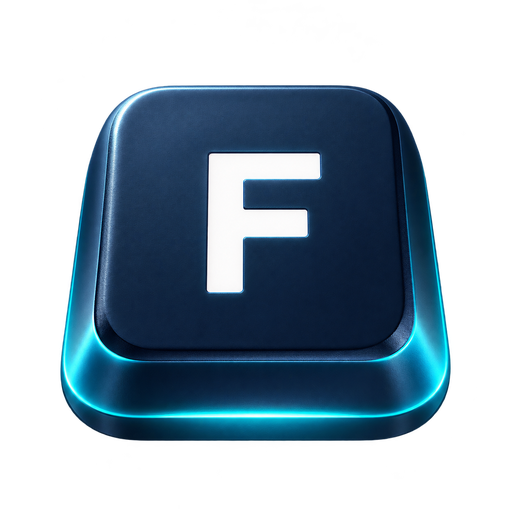

<div align="center">
  

  <h1>FRB Launch</h1>

  <p><strong>操作の入口は小さく。作業する場所は広く。</strong></p>

  <p>アプリ、ファイル、フォルダー、Web、定型入力。<br />Windowsの日常操作を、ひとつの場所から気持ちよく。</p>

  <p>
    
    
    
    
  </p>

  <p>
    <a href="#できること">できること</a> ·
    <a href="#はじめ方">はじめ方</a> ·
    <a href="#設定について">設定について</a> ·
    <a href="#開発ストーリー">開発ストーリー</a>
  </p>
</div>

---

> **昨日の日付を入力するのが、ただ面倒だった。**  
> それだけの理由で作り始めた小さなランチャーが、ホイール操作、ファイル探索、そして小さなリモコンへと育ってしまいました（笑）。

**FRB Launch** は、Windows 11向けの個人開発ランチャーです。  
キーボードから素早く呼び出すことも、マウスホイールを回しながら探すこともできます。

目指しているのは、機能の数を競うことではありません。  
**「次の操作へ進むときの、ほんの小さな面倒」を減らすこと。**

## できること

| 機能 | こんなときに |
| :-- | :-- |
| 🚀 **ランチャー** | アプリ、ファイル、フォルダー、URL、スクリプトをまとめて呼び出す |
| 📅 **定型入力・変数展開** | 今日・昨日の日付や、よく使う文章を入力する |
| 🔎 **検索・履歴** | 登録メニューやファイルを探し、前に使った場所へ戻る |
| 📁 **Files Exp / Files List** | フォルダー階層とファイル一覧を行き来する |
| 🖱️ **ホイールナビゲーション** | ホイールで選択・スクロールし、目的の項目を操作する |
| 🎛️ **FRB Remote** | 小さな操作エリアから、Launchの選択・実行・メニュー操作を行う |
| 🌐 **Browser / ブックマーク** | Webページとブックマークを作業の流れに組み込む |
| 🧩 **JSON設定** | メニュー構成・表示・動作をデータとして管理する |

### FRB Remote — マウスをあまり動かしたくない人へ

Launchから派生した、小さな操作用リモコンです。

- **ぐりぐり**：ホイールで対象を選び、クリックなどで操作する
- **WAN（Wheel Adaptive Navigation）**：スクロールと項目移動をつなぐ操作の実験
- **手裏剣メニュー / 手裏剣スクロール**：フリックして、離す。操作感を試すための機能
- **かなフリック**：マウス操作から生まれた日本語入力の実験
- **ワープ差し棒（ぐりぐりスピナー）**：小さな手元の動きから離れた位置を指す、実験的ポインター操作

これらは**操作体験を研究中の機能**です。機能や動作は更新で変わることがあり、一般的なマウスより速い・正確だと実証されたものではありません。

## FRB Launchの考え方

```text
いつも使う機能を登録する
          ↓
検索する・選ぶ・ぐりぐりする
          ↓
その場から実行する
          ↓
「ここ、もう少し気持ちよくならない？」
          ↓
また少し進化する
```

> **操作対象は移動する。操作位置は移動しない。**

FRB Launchの中で繰り返し試しているのは、**人が操作する位置をなるべく変えず、必要な情報や操作を手元へ近づける**という発想です。

## はじめ方

### 動作環境

- **Windows 11（64-bit）** を主な対象として開発
- 通常の操作にはキーボードまたはマウスを使用
- 一部の実験機能はWindowsのマウス操作や外部アプリと連携します

### ZIP配布版（準備中）

初回の一般向け配布では、**FRB Launch本体と設定エディター（FRB Studio）をまとめたZIP**を予定しています。

1. 配布ZIPを任意のフォルダーへ展開する
2. `FRBLaunch.exe` を起動する
3. 必要に応じてメニューやショートカットを設定する

**初回配布に向けて、別PCでの動作とポータブル配置を検証中です。** ダウンロード先（Vector等）は公開後に追記します。現時点で配布版の動作確認が完了したという意味ではありません。

### 開発用ソースから起動する場合

このリポジトリのソースを使う場合は、Windows環境に対応するPythonを用意し、開発ルートの以下を参照してください。

```bat
py -3 -m venv .venv
.venv\Scripts\python.exe -m pip install -r requirements.txt
_run_windows.bat
```

`_build_windows.bat` はWindows用EXEのビルドスクリプトです。開発・ビルド時には別途依存パッケージのインストールが必要です。配布版とは手順が異なります。

## 基本操作

| 操作 | 内容 |
| :-- | :-- |
| `Ctrl + Shift + ;` | Launchを呼び出す（初期設定例。JSONで変更可能） |
| 矢印キー | メニューの選択・階層の移動 |
| `Enter` | 選択した項目を実行 |
| `Ctrl + F` | 検索へ移動 |
| マウスホイール | 対応する画面でスクロール・選択 |

表示モードや機能によって操作方法が異なります。Remoteやポインター系は実験的な機能です。

### マウスポインター自動移動（配布版では初期OFF）

マウスポインターの自動移動は、新規インストール時には **OFF** です。使用したいときはLaunchの歯車設定から **「マウスポインター自動移動 ▶ ON」** を明示的に選択してください。Citrix／VDIなど自動移動が難しい環境ではOFFのまま使用できます。

OFFで起動すると、設定場所を案内するバルーン風通知が表示されます。「今後表示しない」を選んだ場合は、次回以降の起動で通知を出しません。「あとで」はその回だけ閉じます。以前のLaunchでON/OFFを保存済みなら、その設定は引き継ぎます。

## 設定について

運用設定JSONは `config/frb_launch_data.json` です。データ形式のバージョンはJSON内の `launch_format_version` で管理します。旧名からの移行手順は `docs/FRBLaunch_0279_ConfigFilenameStable_20261112.md` を参照。


**設定を編集するために、JSONを手書きする必要はありません。**

初回配布では **FRB Studio** を、Launchの**設定エディター**として同梱する方針です。

- メニュー、ページ、フォルダー、アクションなどを編集
- JSONデータと画面定義（ViewDef）を分離
- 設定をファイルとして扱い、あとから見直したり共有したりしやすくする

FRB Studio自体は汎用的なJSON編集アプリですが、**この配布ではLaunchの設定画面という位置づけ**です。

> **注意**：既存の開発者個人用設定には、固有のパスやスクリプトが含まれる場合があります。一般配布版では初期設定を分離する予定です。

## 開発ストーリー

FRB Launchは、最初から完成形を設計して生まれたソフトではありません。使って、違和感を見つけて、また作り直す。その繰り返しから育っています。

- [昨日の日付を入力したくなくて、ランチャーを作った話](https://zenn.dev/frb_tamasub/articles/ai-collaboration06-small-success-frb-launch)
- [マウスホイールぐりぐりが魔法になった話](https://zenn.dev/frb_tamasub/articles/ai-collaboration07-frb-launch-wheel-experience)
- [マウスを動かしたくなくて、リモコンが生まれた話](https://zenn.dev/frb_tamasub/articles/ai-collaboration08-frb-launch-remote-experience)
- [エクスプローラーに魂を吹き込む手裏剣の話](https://zenn.dev/frb_tamasub/articles/ai-collaboration12-shuriken-press-conference)

### なぜ「FRB」なのか？

**FRB = Fishing Rod Benchmark**。もともとは釣り竿の感度を振動として可視化する個人研究から始まりました。

釣り竿でもソフトウェアでも、共通して大事にしているのは、**人間が感じた小さな違いを見逃さないこと**。

[FRBプロジェクト本体](https://github.com/tamasub/FRB) / [FRBの紹介](https://tamasub.github.io/FRB/)

## 開発状況・注意事項

- 個人開発のWindows向けソフトウェアです。仕様やUIは更新で変更される場合があります。
- 一部の機能はファイル操作、スクリプト起動、マウス入力など、Windows上の操作を実行します。設定内容を確認してから使用してください。
- 大切なファイルは事前にバックアップしてください。特にファイル操作機能や実験機能は慎重にお試しください。
- ライセンス・再配布条件・正式なサポート窓口は、公開版の整備とあわせて明記します。

---

<div align="center">
  <p><strong>完成した答えよりも、答えからこぼれ落ちた違和感を大切にする。</strong></p>
  <p><sub>Fishing Rod Benchmark［FRB］ · By tamasub</sub></p>
</div>

### 公開版の操作メモ
- 「ワープ差し棒 ～ぐりぐりスピナー～（上下追従）」は、使用しない／Files List・Exp直接選択／Windowsマウス方式から選択できます。上下追従は有効な方式に自動付随します。
- 手動登録した単独のHTTP(S) Openアクションは、外部ブラウザーを明示しなければLaunch内Browserの新規タブで開きます。Chrome・Edgeを明示した場合は外部起動のままです。
- Compact表示の切替ボタンは残し、コンテキストメニューの重複項目だけ非表示にしました。
